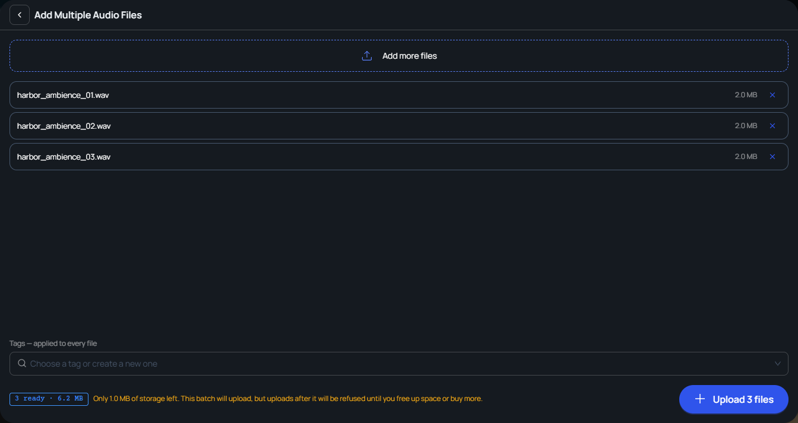

Change · Web · Released [2026-10-20](/spark/changelog/changelog#2026-10-20)

Your organization's storage limit now works by one rule. While the storage used is under the limit, an upload goes ahead, even one that takes the organization over the limit. Once the storage used reaches the limit, new uploads are refused until you delete files or buy more storage.

Before, Spark refused an upload that was larger than the storage left, even when the organization was not yet full.

## What stops at the limit

Once your organization is at its storage limit, Spark refuses anything that adds stored files:

- Uploading files in the **Asset Library**, with **Add to Library** or **Add Multiple**.
- Saving a CG Take preview.
- Saving a take's background.
- Exporting from the Editor.
- Uploading a take from the Spark iOS app.
- Adding one of the **Default assets** in the **Asset Library** to your production, with **Import & Edit Metadata** or **Import & Download**. This is new. Before, the limit did not stop it.
- Uploading a **Production Image** in **Production Settings**. This is new. A production image does not count toward the storage used, but it is refused once the organization is at its limit.

When an upload is refused, a message reads **Your organization is out of storage. Delete files or buy more storage from Organization → Settings → Billing.**

A CG Take preview is rendered first and refused when Spark saves it. The message reads **Your organization is out of storage. CG Take previews can't be saved. Delete files or buy more storage from Organization → Settings → Billing.** The take keeps its old preview.

Viewing, downloading, renaming, and deleting files still work at the limit.

The limit is checked again on every upload. As soon as you delete files or buy more storage, you can upload again.

## Adding several files at once

**Add Multiple** in the **Asset Library** opens a window that checks the storage left before you start.

- If your organization is already out of storage, a red line reads **Your organization is out of storage — remove some files or buy more from Organization → Settings → Billing.** The upload button, such as **Upload 3 files**, is greyed out.
- If the files are larger than the storage left, an amber line reads **Only 1.0 MB of storage left. This batch will upload, but uploads after it will be refused until you free up space or buy more.** The amount is the storage your organization has left. The upload button stays on.

If the limit is reached partway through a batch, the rest of the files are not uploaded. A message such as **Your organization is out of storage, so 1 more file(s) were not uploaded. Delete files or buy more storage from Organization → Settings → Billing.** appears, and the transfers panel reads **Transfers finished with errors**.

Before, a batch larger than the storage left showed a red line, **Only 1.0 MB of storage left — remove some files or buy more from Organization → Settings → Billing.**, and the upload button was greyed out.

## Exporting from the Editor

Spark checks the storage before an export starts, so you do not wait for a render that cannot be saved. If your organization is out of storage, the message **This organisation is out of storage. Delete something or add storage first.** appears, and the export does not start.

Before, Spark estimated the size of the export and refused it if it was larger than the storage left, with the message **This export is larger than the storage left on this organisation. Delete something first.**

## What counts toward storage

The files of your takes and the preview pictures of your files now count toward the storage used. Before, they did not. Spark recounted every organization's storage when this release went out, so the storage used under **Storage** in **Billing** may have changed.

When the storage used reaches the limit, **Billing** shows **Storage cap exceeded. New uploads are blocked until you delete files or buy more storage.**
