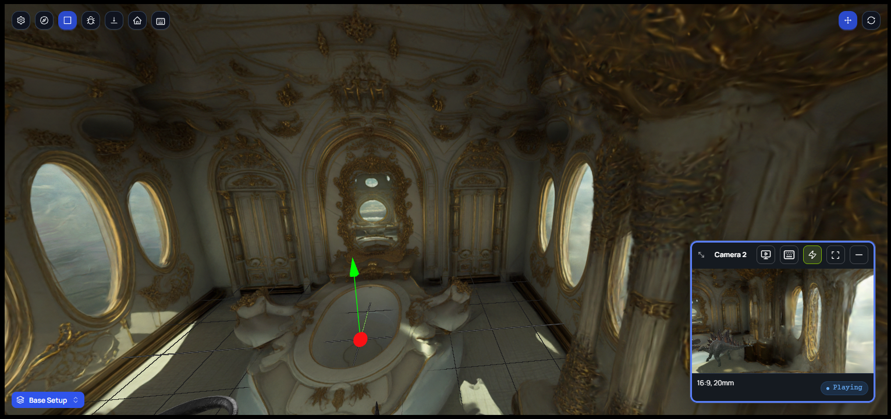

Change · Web · Released [2026-11-03](/spark/changelog/changelog#2026-11-03)

In the 3D scene, the main view and the camera preview now take the move keys the same way. Click a view, and **W**, **A**, **S**, and **D** move that view. A blue outline shows which view the keys move.

Before, the camera preview moved only while you held the mouse button down on it, and the main view stopped taking the keys when you clicked a panel.

## Choosing the view the keys move

1. Click the camera preview. A blue outline appears around it.
2. Press **W**, **A**, **S**, or **D**. The camera moves, and the main view stays where it is.
3. Click the main view. The outline moves to the main view, and the keys now move the main view.

Only one view has the outline at a time. Clicking a panel, such as the Outliner, leaves the outline where it is, so the keys still move the same view. When the page opens, neither view has the outline, and the keys do nothing until you click a view.

The **Controls** button (the keyboard) on the preview's top bar opens the preview's key help. It now reads **Drag on the preview to look around** and **Click the preview, then use W / A / S / D to move**.

## Undoing a move

Spark saves the camera's new position when it stops moving. Quick taps in a row count as one move, so one **Ctrl+Z** puts the camera back.

To cancel a move before Spark saves it, press **Esc** right after you stop. The camera goes back to where it was and stays selected.

## Minimizing the preview

**Minimize** on the preview leaves neither view with the outline, and the keys do nothing. **Show preview** brings the preview back without the outline. Click the preview to move its camera again.
