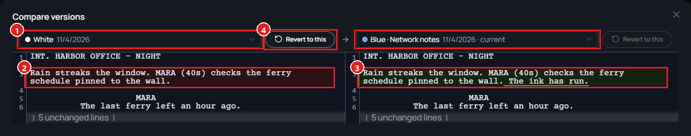

Change · Web · Released [2026-11-03](/spark/changelog/changelog#2026-11-03)

The window that compares script versions is now called **Compare versions**, and it can compare any version with any other. Before, the **Version History** window compared a version only with the one before it.

## Comparing two versions

1. On the script page, click **Compare** in the title bar. Its tooltip reads **See what changed since the previous published revision**. You can also click a version card in **Versioning** to compare that version with the one before it.
2. The **Compare versions** window shows two versions side by side. Each side has a picker with two groups, **Published** and **Drafts**. Choose a version on each side.

The older side is shown in red and the newer side in green, whichever side you put it on. An arrow between the pickers points from the older version to the newer one.

1. The pickers. Each lists a **Published** group and a **Drafts** group.
2. The older version, in red.
3. The newer version, in green.
4. **Revert to this** works only on the older side.

## Reverting to the older version

1. Click **Revert to this** on the older side. Its tooltip reads **Save this version's text as a new version**.
2. Spark asks **Revert to version** with the version's number. Click **Revert**.

The message **Reverted to version** with the number appears. The revert is saved as a new draft, so the script everyone reads does not change until you publish. In View, the page shows **Unpublished edits** with **Review & publish**.
