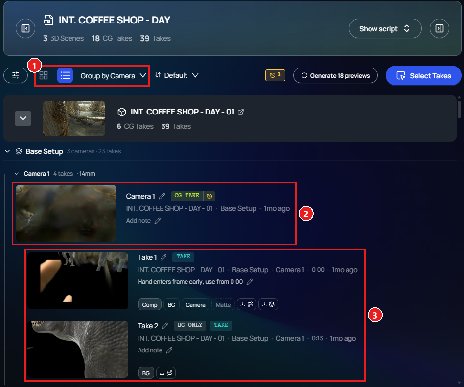

Change · Web · Released [2026-11-03](/spark/changelog/changelog#2026-11-03)

The Gallery now opens in **List**, grouped with **Group by Camera**. Each camera has a group of its own: its CG Take first, and the takes recorded on that camera indented under it. Before, the Gallery opened grouped by setup.

The new start applies only until you choose something else. The Gallery remembers your choice of **Grid** or **List** in this browser, as it already remembered the grouping.

A custom list still opens with **No grouping**, in the order you arranged it.

1. **Group by Camera**, and the **Grid** and **List** switch.
2. A camera's CG Take.
3. The takes recorded on that camera.
