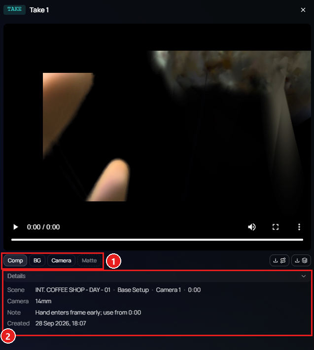

Change · Web · Released [2026-11-03](/spark/changelog/changelog#2026-11-03)

When you click an item in the Gallery, it plays in the player panel. The player now shows the take's layer chips and a **Details** section, and it always shows the whole frame.

## Layers

Under the picture, a take has the same layer chips as its card, such as **Comp**, **BG**, and **Camera**. Click a chip to play that layer in the player. It carries on from the same moment. The card itself keeps showing its own layer. A CG Take has one picture and no chips.

## Details

Under the chips, **Details** lists what is playing, one line each: **Scene**, **Camera**, **Action**, **Note**, and **Created**. A line shows only when there is something to say. Click **Details** to put the section away and give the picture more room. The player remembers your choice in this browser.

1. The layer chips. The lit chip is the layer that plays.
2. **Details**, with the button that hides or shows it.

## The whole frame

The player always shows the whole frame, with black bars where the shapes differ. Before, it had a **Fit** and **Fill** switch and started on **Fill**, which cropped the frame. The cards still offer both, under **Appearance**.
