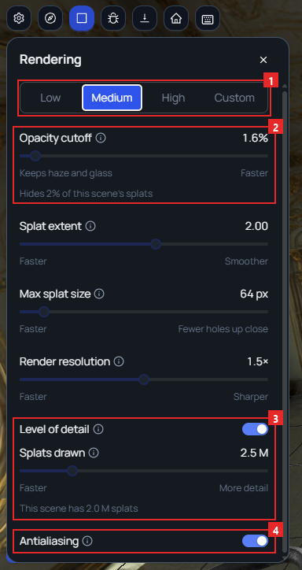

Feature · Web · Released [2026-11-03](/spark/changelog/changelog#2026-11-03)

A new **Rendering** panel in the 3D scene sets how splats are drawn. Choose **Low**, **Medium**, or **High**, or move a slider to make your own **Custom** settings. The scene changes while you move a slider, so you can judge the result as you go.

## Opening the Rendering panel

Open the panel in one of two ways:

- Click the gear (**Settings**) on the 3D canvas toolbar, then click **Rendering…**.
- Select a splat location, and click **Render quality settings** in its properties, under **Rendering**.

The panel opens at the upper left of the canvas, under the toolbar. The scene stays visible, and you can still work in it. To close the panel, click the **X** or press **Esc**.

1. The presets. The one in use is highlighted.
2. **Opacity cutoff**, with the line that says how much of this scene it hides.
3. **Level of detail** and **Splats drawn**, with the line that says how many splats the scene has.
4. **Antialiasing**.

## Presets

A preset sets every value in the panel at once.

| Setting | Low | Medium | High |
|---|---|---|---|
| **Opacity cutoff** | 3.1% | 1.6% | 0.2% |
| **Splat extent** | 1.50 | 2.00 | 2.83 |
| **Max splat size** | 48 px | 64 px | 512 px |
| **Render resolution** | 1× | 1.5× | 2× |
| **Level of detail** | On | On | Off |
| **Splats drawn** | 1.5 M | 2.5 M | Greyed out |
| **Antialiasing** | Off | On | On |

**Medium** is the starting preset. **High** draws every splat.

On **Low**, splats close to the camera look grainier, like small hard flakes. **High** draws them smoother.

When you move any slider or switch, the preset changes to **Custom**. Your Custom values stay after a reload. Clicking **Low**, **Medium**, or **High** replaces them with that preset's values.

Your choice applies to every scene you open on this device. A splat location's properties name the preset in use, such as **Medium preset · applies to every scene on this device**.

## The settings

Each setting has an info icon beside its name that explains what it does. The words under the two ends of a slider say what you get at each end.

| Setting | What it does | Left end | Right end |
|---|---|---|---|
| **Opacity cutoff** | Splats fainter than this are not drawn. Too high, and clouds, haze, and glass disappear. | Keeps haze and glass | Faster |
| **Splat extent** | How far each splat's soft edge reaches. | Faster | Smoother |
| **Max splat size** | The largest a single splat can get on screen. Too low leaves holes in near surfaces, such as foliage. | Faster | Fewer holes up close |
| **Render resolution** | The highest pixel ratio the canvas renders at. It never goes above your screen's own. | Faster | Sharper |
| **Level of detail** | A switch. On, Spark draws a lighter version of large locations. Off, it draws every splat. | | |
| **Splats drawn** | How many splats **Level of detail** draws each frame, across every location in the scene. It is greyed out while **Level of detail** is off. | Faster | More detail |
| **Antialiasing** | A switch. It smooths the edges of models and the grid. It has no effect on splats. | | |

Two lines under the sliders describe the scene you have open:

- Under **Opacity cutoff**, a line such as **Hides 2% of this scene's splats**. On **High**, it reads **Hides under 1% of this scene's splats**. When the cutoff is higher than the **Low** preset's, the line turns amber, with a warning sign.
- Under **Splats drawn**, a line such as **This scene has 2.0 M splats**.

## Changing antialiasing

A change to **Antialiasing** takes effect after the page reloads. When you change it, the panel reads **Takes effect after a reload.** Click **Reload now** to reload the page. Choosing a preset with a different **Antialiasing** value shows the same line.

## Previews and exports

Renders that Spark saves, such as exports and upload thumbnails, always draw splats with the **High** values. Your choice in the panel does not change them.
