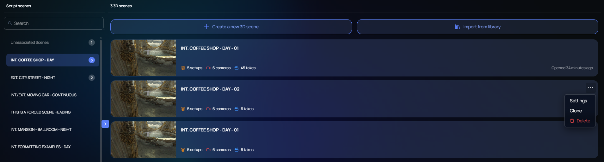

Change · Web · Released [2026-11-03](/spark/changelog/changelog#2026-11-03)

On the script page, click the blue arrow on the left edge of the 3D scenes panel to collapse the script. The panel now lists the 3D scenes as full-width rows. Before, each scene card was stretched across the page.

Each row shows the scene's picture, its name, and its counts of setups, cameras, and takes. Point at a row to open its **…** menu.

**Unassociated Scenes** now stays in the left column all the time, so the headings no longer move down when you start to drag a scene.
