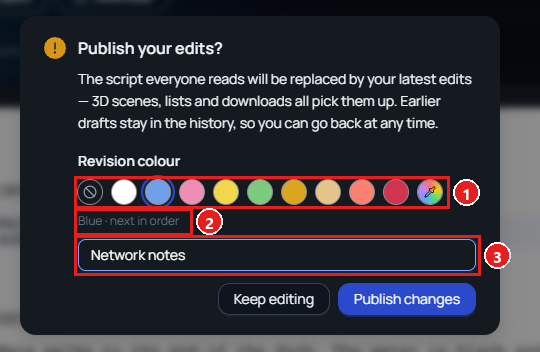
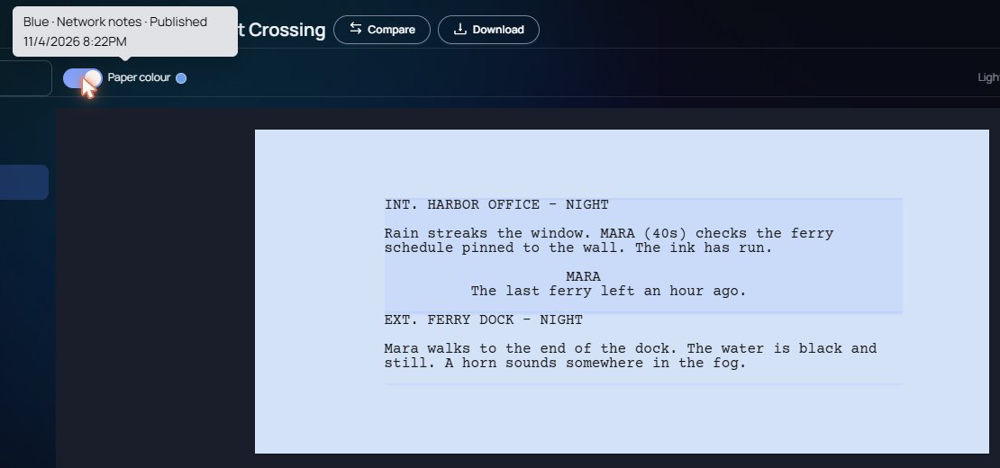

Feature · Web · Released [2026-11-03](/spark/changelog/changelog#2026-11-03)

When you publish a script, you can now give the revision a colour from the standard order of script revisions, and a name. The script page can show the paper in that colour, and the version cards carry it too.

## Choosing a colour when you publish

1. Open the script in Edit and make your changes.
2. In **Versioning** on the right, click **Publish changes**.
3. The window **Publish your edits?** has a **Revision colour** row. Click a colour.
4. Optionally, type a name in the box under the colours, such as `Network notes`.
5. Click **Publish changes**. The message **Changes published — everyone sees them now** appears.

The colours follow the standard order: **White**, **Blue**, **Pink**, **Yellow**, **Green**, **Goldenrod**, **Buff**, **Salmon**, and **Cherry**. The first swatch is **No colour**, and the last one, **Your own colour**, opens a colour picker.

Until a script has a coloured publish, the window starts on **No colour**. After that it starts on the next colour in the order, and the line under the swatches says so, such as **Blue · next in order**. When a colour comes round a second time, its name says so, such as **Double White**.

1. The revision colours. **No colour** is first, and **Your own colour** is last.
2. The colour Spark suggests next.
3. The revision's name.

## Seeing the colour on the page

When the script's current revision has a colour, a **Paper colour** switch with a dot of that colour sits at the left of the toolbar, in View and in Edit. It is on unless you turn it off, and the page is tinted with the colour. Spark remembers the switch in your browser. Point at it to see the revision's name and when it was published, such as **Blue · Network notes · Published 11/4/2026 8:22PM**.

A script whose current revision has no colour has no **Paper colour** switch.

## Colours on the version cards

In **Versioning**, a published card has a stripe of its revision's colour on the left, its revision name, and who published it and on what date. Ribbons mark the cards: **CURRENT** for the revision everyone reads, **PUBLISHED** for earlier publishes, and **IMPORTED** for an uploaded script. Drafts saved after a publish keep that publish's stripe.

To compare two versions, see [compare any two versions of a script](/spark/changelog/updates/2026-11-03/compare-any-two-script-versions).
