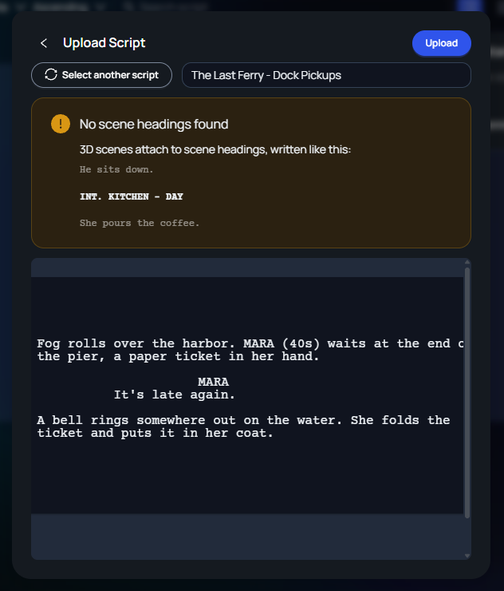
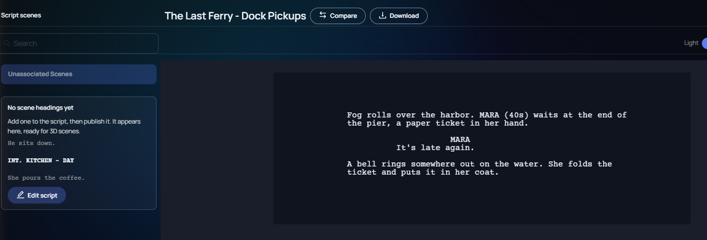

Change · Web · Released [2026-11-03](/spark/changelog/changelog#2026-11-03)

3D scenes attach to the scene headings of a script, such as `INT. KITCHEN - DAY`. A script with no scene heading now gets a warning when you upload it, and its 3D scenes are listed under **Unassociated Scenes**. Before, the script page showed only **Headings will appear here**, and you could not reach that script's 3D scenes from it.

## When you upload the script

The upload preview shows a box titled **No scene headings found**. It reads **3D scenes attach to scene headings, written like this:**, with an example: a heading between two lines of action, with a blank line above and below it. **Upload** still works.

## On the script page

The left column lists **Unassociated Scenes** and selects it. Under it, a box titled **No scene headings yet** reads **Add one to the script, then publish it. It appears here, ready for 3D scenes.**, with the same example and an **Edit script** button. You can create 3D scenes under **Unassociated Scenes** while the script has no heading.

When you add a heading and publish the script, the box goes away and the heading is listed in the left column.

## In the 3D scene and the Gallery

In a 3D scene of such a script, the **Scene navigation** drawer lists **Unassociated Scenes** with **This script has no scene headings yet.** and the link **Open the script**. The Gallery opens on **Unassociated Scenes** for such a script and shows the same line.
