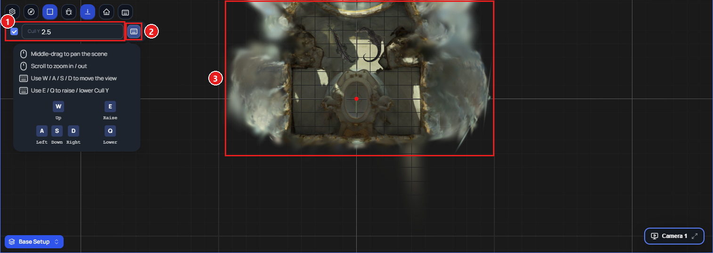

Change · Web · Released [2026-11-03](/spark/changelog/changelog#2026-11-03)

In the top-down view, **Cull Y** now cuts USD objects and splats at the same height, and the value you set is the height of the top-down camera. Before, **Cull Y** cut only splats, and USD objects stayed cut at whatever height you had been flying. The **Cull Y** bar now also shows in a scene that has no splat.

## Setting the cut

1. Click **Top-Down View** in the toolbar of the 3D canvas.
2. In the **Cull Y** bar, drag the value or type a height. Everything above that height is cut away. Shot cameras above the cut are hidden too; their names still show.

- Untick the box beside **Cull Y** to see the whole scene. Tick it again to go back to the last height you used.
- Click the 3D canvas, then press **E** to raise the cut and **Q** to lower it, by 0.5 each time. They do nothing while **Cull Y** is unticked. **W**, **A**, **S**, and **D** move the view.
- **Reset view** centres the view again and keeps the **Cull Y** height.

## The controls

Click the keyboard button at the end of the **Cull Y** bar (tooltip **Controls**) to see the top-down controls:

- **Middle-drag to pan the scene**
- **Scroll to zoom in / out**
- **Use W / A / S / D to move the view**
- **Use E / Q to raise / lower Cull Y**

1. The **Cull Y** box and value.
2. The keyboard button, which opens the controls.
3. The splat room and the USD object inside it, cut at the same height.
