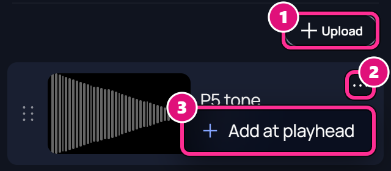
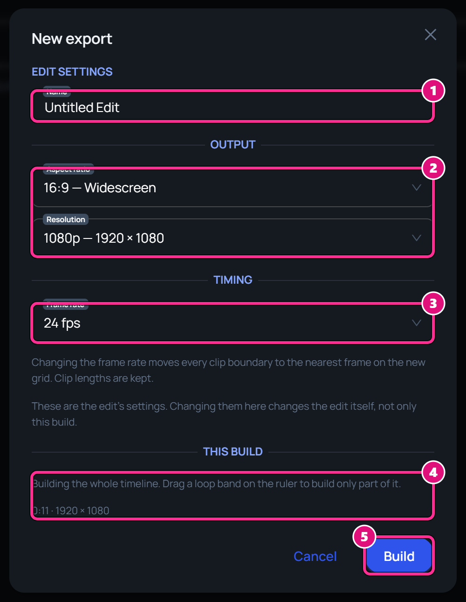
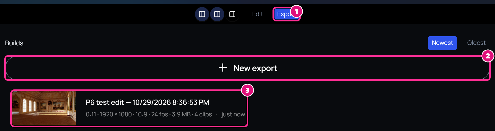
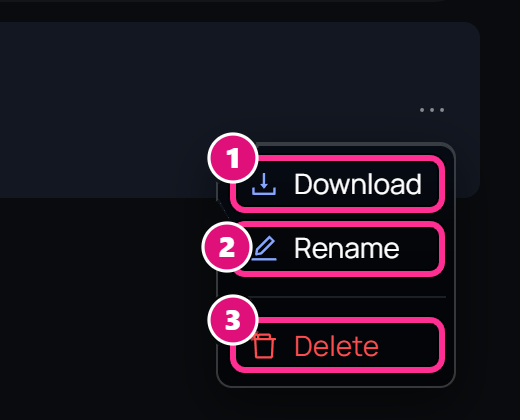

## Add audio

1. Click the **Audio** tab. To add a file, click **Upload**.
2. On an audio file's **…** menu, click **Add at playhead**. It goes on the audio lane.

1. **Upload**
2. **…**
3. **Add at playhead**

## Export an edit

<Steps titleSize="h3">
  <Step title="Open the builds">
    At the top, click **Export**, then **New export**.
  </Step>
  <Step title="Check the settings">
    Set the name, aspect ratio, resolution and frame rate. These change the edit itself as well as this build. **This build** covers the whole timeline. To build part of it, drag a loop band on the ruler first.

    

    

    1. **Name**
    2. **Aspect ratio** and **Resolution**
    3. **Frame rate**
    4. **This build**
    5. **Build**

    

  </Step>
  <Step title="Build it">
    Click **Build**. An 11-second edit took about 18 seconds. The build joins the **Builds** list.

    

    

    1. **Export**
    2. **New export**
    3. Build

    

  </Step>
  <Step title="Download it">
    On the build's **…** menu, click **Download**. The file is an MP4.

    

    

    1. **Download**
    2. **Rename**
    3. **Delete**

    

  </Step>
</Steps>

A build that fails or is canceled leaves nothing in the list.

Spark checks your organization's storage before an export starts. If it's full, the export doesn't start. See [Storage](/spark/scene-editor/asset-library#storage).

## Related

<CardGroup cols={2}>
  <Card title="Build an edit" icon="scissors" href="/spark/editing/editor">
    Cut takes into a rough cut.
  </Card>
  <Card title="Shoot with Jetset" icon="video" href="/spark/export-jetset/shoot-with-jetset">
    Send a 3D scene to Jetset for the set.
  </Card>
</CardGroup>
