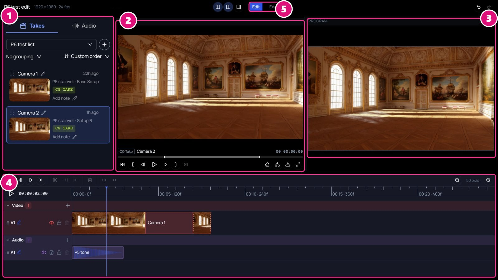
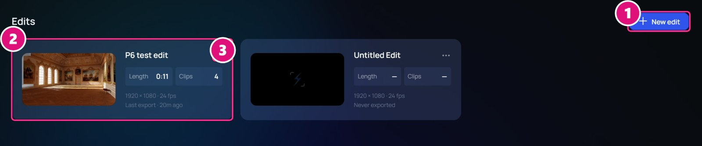
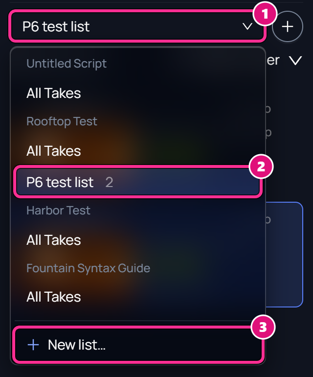
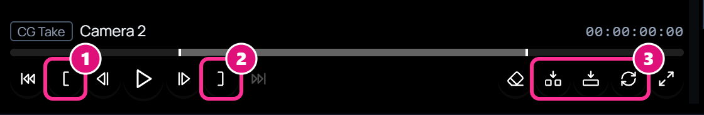
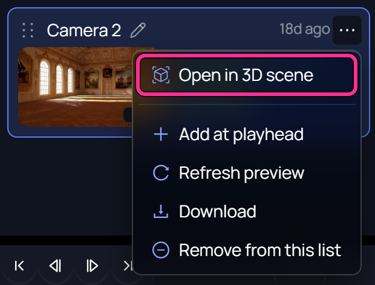

The Editor works with takes from the Gallery and your own audio files. An edit exports as an MP4.

1. **Takes** and **Audio**
2. **CLIP** viewer
3. **PROGRAM** viewer
4. Timeline
5. **Edit** and **Export**

- The **CLIP** viewer plays the take or clip you pick.
- The **PROGRAM** viewer plays the edit.
- The timeline has a **Video** lane, V1, and an **Audio** lane, A1. Click **+** beside **Video** or **Audio** to add a lane.

## Create an edit

1. Click the **Editor** tab at the bottom of the production.
2. Click **New edit**. It opens as **Untitled Edit**, 1920 × 1080 at 24 fps.

1. **New edit**
2. Edit
3. **…**

To rename an edit, change **Name** when you export it. See [Export an edit](/spark/editing/audio-and-export#export-an-edit).

## Cut takes into an edit

<Steps titleSize="h3">
  <Step title="Pick where the takes come from">
    On the **Takes** tab, open the picker. It lists every script and every list in the production, and **New list…**.

    

    

    1. Picker
    2. A list
    3. **New list…**

    

  </Step>
  <Step title="Mark the part you want">
    Click a take to load it in the **CLIP** viewer. Move the playhead and click **Mark in**, then move it again and click **Mark out**. A still from a **STATIC** CG Take can't be marked.
  </Step>

  <Step title="Put it on the timeline">
    Click **Insert** to add it at the playhead and push later clips along. Click **Overwrite** to cover what's there. You can also drag a take onto a lane.

    

    

    1. **Mark in**
    2. **Mark out**
    3. **Insert**, **Overwrite** and **Replace**

    

  </Step>
</Steps>

Without marks, **Insert** adds the whole take. A still goes in 5 seconds long.

The timeline toolbar splits a clip at the playhead, trims its start or end, and removes clips. **Close every gap** pulls the clips together. Press **Ctrl** and scroll to zoom the timeline.

<AccordionGroup>
  <Accordion title="Editor keys">
    | Key | Does |
    |---|---|
    | Space | Play or pause |
    | ← or → | One frame back or forward |
    | Shift+← or Shift+→ | 1 second back or forward |
    | Shift+↑ or Shift+↓ | The start, or the end of the last clip |
    | I or O | Mark in or Mark out |
    | Alt+X | Clear the marks |
    | V or B | Insert or Overwrite |
    | R | Replace the clip at the playhead |
    | Ctrl+K | Split |
    | Q or W | Trim the start or the end |
    | G | Close a gap |
    | Delete | Remove the selection (Backspace on a Mac) |
    | Ctrl+Z or Ctrl+Shift+Z | Undo or redo |
  </Accordion>
</AccordionGroup>

## Replace a clip

Replace swaps a clip for another take, CG Take or audio file. The new clip starts where the old one did, and nothing else on the timeline moves.

- Drag a take from the left column onto a clip. The clip shows an amber **Replace** tag, and a tint over the part the new material fills. Then let go.
- Or move the playhead onto the clip and load the new material in the **CLIP** viewer. Then click **Replace**, or press **R**.

Shorter material ends early and leaves a gap. Spark tells you its length. Longer material is cut to the old clip's length. If you marked part of the take, only that part is used.

Video replaces video, and audio replaces audio. **Ctrl+Z** puts the old clip back.

## Open a take in its 3D scene

On a take's **…** menu in the left column, click **Open in 3D scene**. The 3D scene opens with the take's camera selected.

- A take recorded with no camera selected opens its 3D scene with nothing selected.
- A take that isn't linked to a 3D scene shows the item grayed out.
- **Ctrl**+click opens the 3D scene in a new tab.

## Choose which video a clip plays

A clip cut from a Take can play any of its videos: **Comp**, **BG**, **Camera**, **Matte** or **Depth**. A CG Take is one video.

Select a clip to see its properties in the inspector (**Shift+I**). There you can set the clip's framing, rotate it 90° either way, or mute it. A clip hidden under a higher lane is flagged **It will not appear in the export.**

## Related

<CardGroup cols={2}>
  <Card title="Add audio and export" icon="file-video" href="/spark/editing/audio-and-export">
    Add sound, then export an MP4.
  </Card>
  <Card title="Browse and play takes" icon="images" href="/spark/gallery/gallery">
    Find a take and play it.
  </Card>
</CardGroup>
