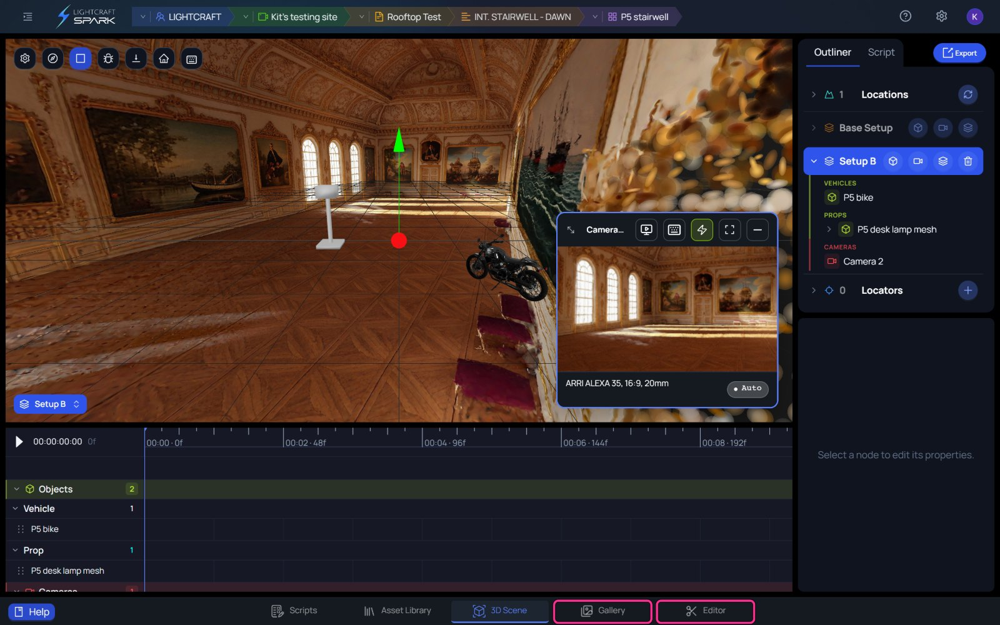

This is stage 5 of 5. After you [review takes](/spark/gallery/overview) in the Gallery, you cut them into an edit in the Editor.

## Open the Editor

Open a production, then click **Editor** in the tabs at the bottom.

## Common tasks

| Task | Page |
|------|------|
| Create an edit | [Build an edit](/spark/editing/editor#create-an-edit) |
| Cut takes into an edit | [Build an edit](/spark/editing/editor#cut-takes-into-an-edit) |
| Replace a clip | [Build an edit](/spark/editing/editor#replace-a-clip) |
| Add audio | [Add audio and export](/spark/editing/audio-and-export#add-audio) |
| Export an edit | [Add audio and export](/spark/editing/audio-and-export#export-an-edit) |
