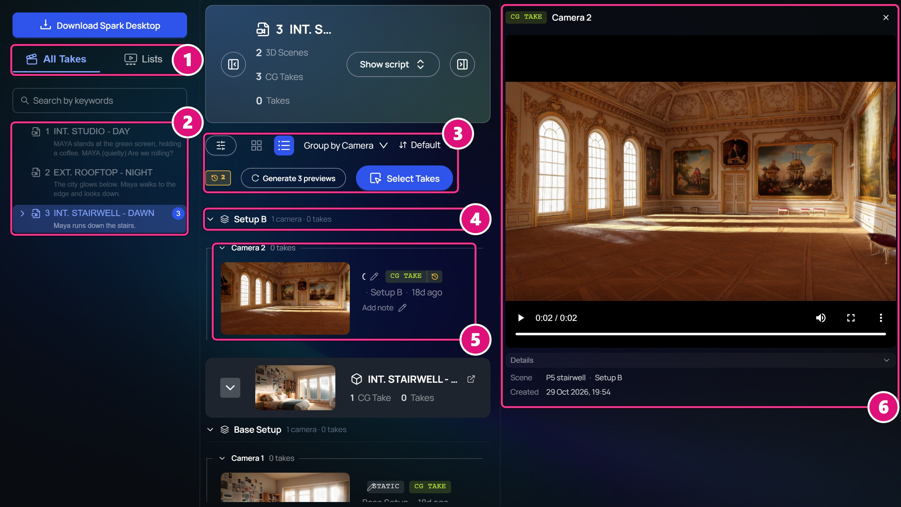
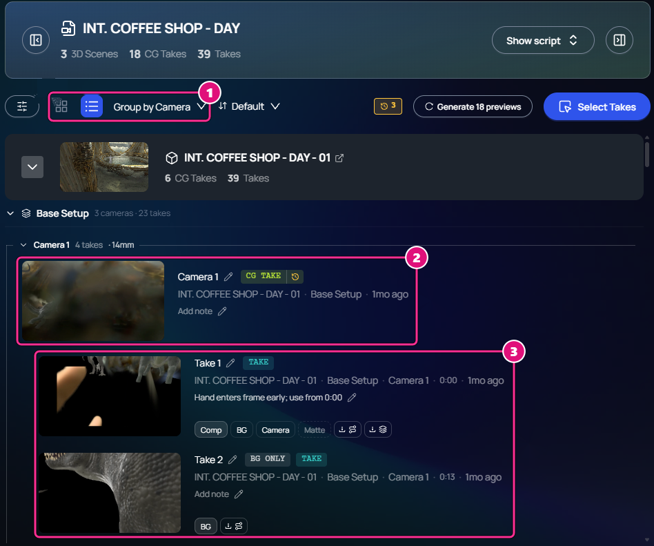
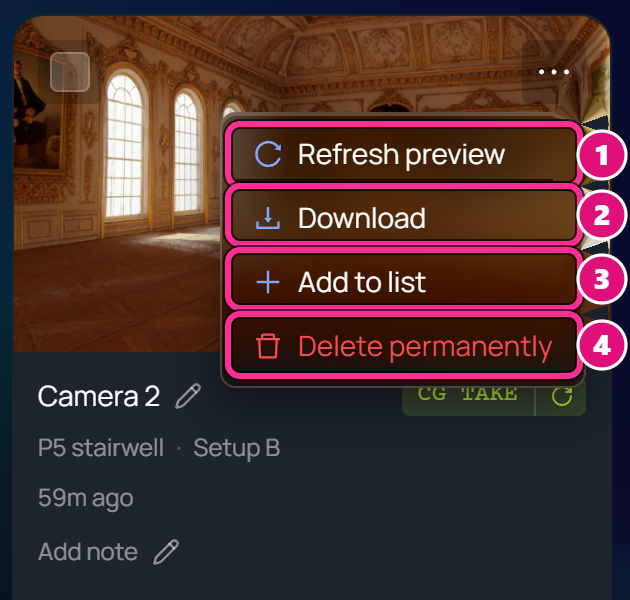
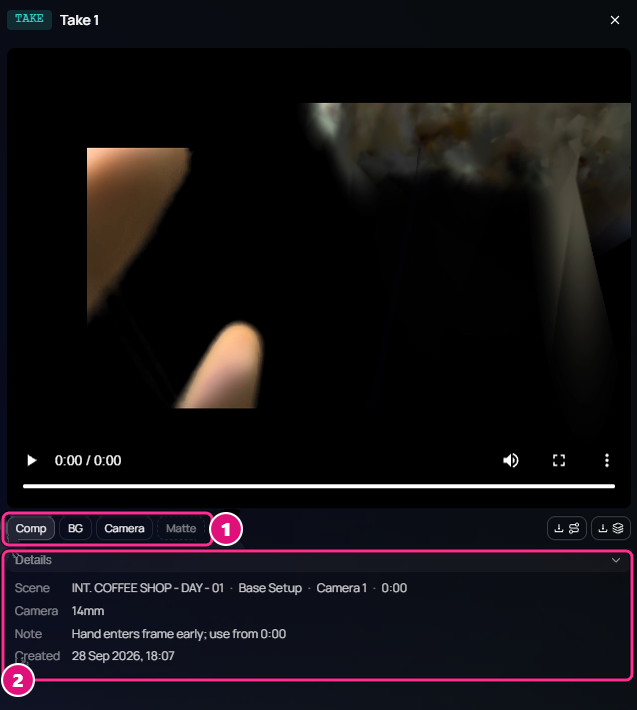

The Gallery holds every take in a production. A CG Take is a camera's CG previz render of its move through a 3D scene. A Take is a recording from the Spark iOS app.

1. **All Takes** and **Lists**
2. Scene headings
3. Toolbar
4. Setup row
5. Camera group
6. **Player** and **Details**

## All Takes and Lists

**All Takes** shows the takes of the open script. Pick a scene heading in the sidebar to see its 3D scenes.

The Gallery opens as a list with **Group by Camera**. Each camera has its own group: its CG Take first, then the takes recorded on that camera, indented under it.

1. View and **Group by**
2. A camera's CG Take
3. Takes on that camera

The toolbar sets how takes show:

- **Group by**: **No grouping**, **Group by 3D Scene**, **Group by Setup** or **Group by Camera**
- Sort: **Default**, or **Date created**, newest or oldest first
- Grid or list view

The Gallery remembers your grouping and view in this browser. A list you made opens with **No grouping**, in the order you arranged it.

**Lists** holds the lists you make. See [Create and edit a list](/spark/gallery/lists-and-sharing#create-and-edit-a-list).

## Takes and CG Takes

Every camera in a 3D scene gets a CG Take card, before you record anything. A card shows its preview, name, chips, 3D scene and setup, age and note. Click the pencil beside the name, or **Add note**, to change them.

The chips say what the card is:

- **CG TAKE**: the camera's CG previz render of its move through the 3D scene
- **TAKE**: a recording from the Spark iOS app
- **STATIC**: the camera doesn't move, so the preview is a still
- **BG ONLY**: recorded with the iPhone's camera off, so the CG background is all it has

Click a preview to play it in the **Player**. See [Play a take](#play-a-take). Hover a card for its select box at the top left and **…** at the top right.

1. **Refresh preview**
2. **Download**
3. **Add to list**
4. **Delete permanently**

## Take layers

A Take card shows a chip for each layer the take has: **Comp**, **BG**, **Camera**, **Matte** and **Depth**. Its download chips are **Tracking**, **Depth (raw)** and **G-matte**. A missing layer shows a dashed chip that says why.

Takes arrive once they're uploaded. See [Upload takes from iPhone](/spark/gallery/spark-desktop).

## Play a take

Click a picture to play it in the **Player**. The Player shows the whole frame, with black bars where the shapes differ.

1. Layer chips
2. **Details**

- Click a layer chip to play that layer from the same moment. A CG Take has one picture and no chips.
- **Details** lists **Scene**, **Camera**, **Action**, **Note** and **Created**. A line shows only when it has something to say.
- Click **Details** to hide the section. The Player remembers that in this browser.

## Related

<CardGroup cols={2}>
  <Card title="Render and download takes" icon="download" href="/spark/gallery/render-and-download">
    Render previews, download files and delete takes.
  </Card>
  <Card title="Share takes in lists" icon="share-2" href="/spark/gallery/lists-and-sharing">
    Collect takes in a list and share its link.
  </Card>
</CardGroup>
