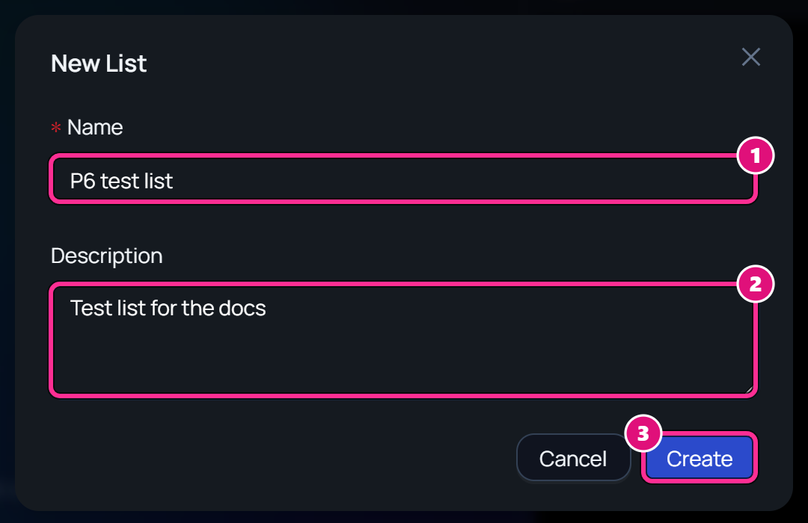
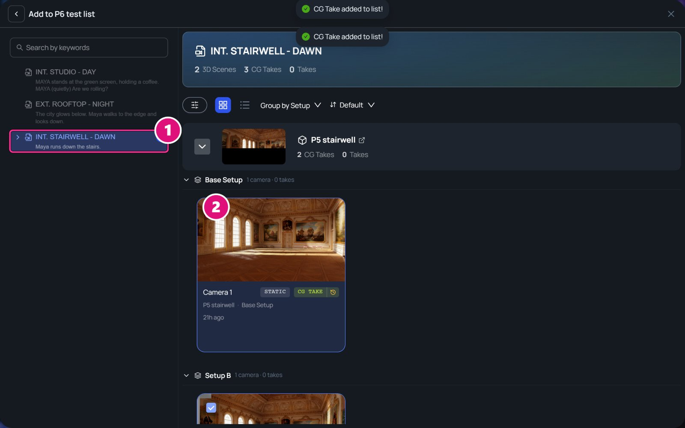
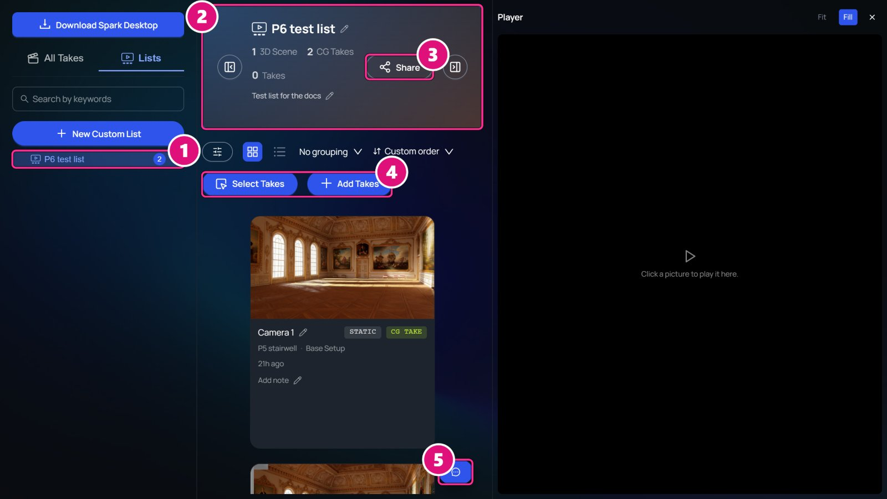
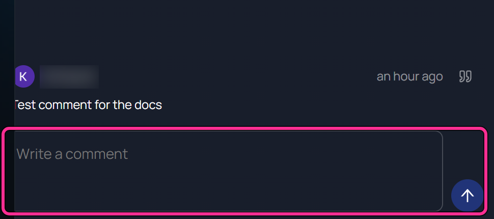
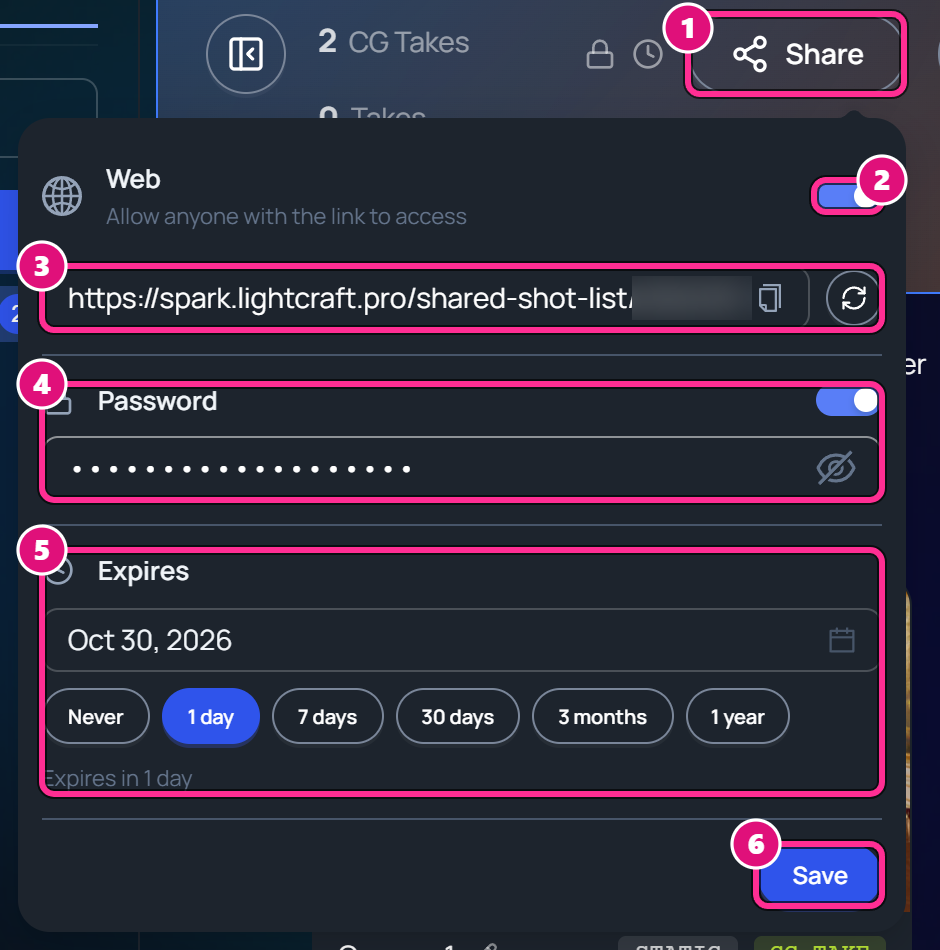
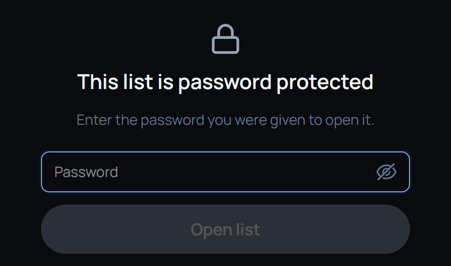
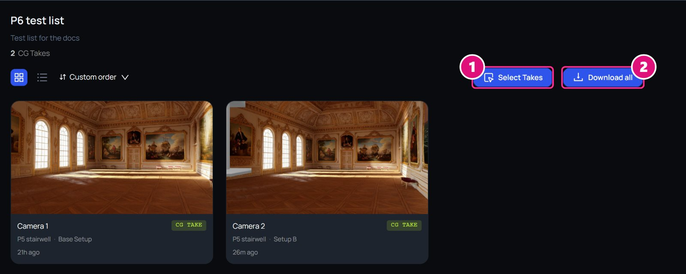

A list collects CG Takes and Takes from anywhere in the script.

## Create and edit a list

<Steps titleSize="h3">
  <Step title="Make the list">
    On the **Lists** tab, click **New Custom List**. Enter a name and, if you like, a description, then click **Create**.

    

    

    1. **Name**
    2. **Description**
    3. **Create**

    

  </Step>
  <Step title="Add takes">
    Open the list and click **Add Takes**. Tick a card to add it. You can also use **Add to list** on any card.

    

    

    1. Scene heading
    2. Ticked card

    

  </Step>
</Steps>

The list's page holds its takes and tools.

1. List
2. Header
3. **Share**
4. **Select Takes** and **Add Takes**
5. Comments

- To rename the list or change its description, click the pencil beside it.
- With **Custom order**, drag cards to reorder them.
- To delete the list, click the trash on its sidebar row. The takes in it stay in the Gallery.

## Comment

Comments belong to a list.

1. On the list, click the round blue button at the bottom right.
2. Enter your comment in **Write a comment** and press **Enter**.

Each comment shows its author's name. To quote a take, click **Quote in comments** on its card's **…** menu while comments are open.

## Share a list with a link

Anyone with the link can open the list without a Spark account.

<Steps titleSize="h3">
  <Step title="Turn on the link">
    On the list, click **Share**, then turn on **Web**.
  </Step>
  <Step title="Set a password and an expiry">
    Turn on **Password** and enter one. Under **Expires**, pick how long the link works: **1 day**, **7 days**, **30 days**, **3 months**, **1 year** or **Never**. You can also pick a date.
  </Step>
  <Step title="Save and copy the link">
    Click **Save**, then copy the link and send it.

    

    

    1. **Share**
    2. **Web**
    3. Link
    4. **Password**
    5. **Expires**
    6. **Save**

    

  </Step>
</Steps>

To stop the link working, turn off **Web**. **Refresh link** makes a new link, and the old one stops working for everyone who has it.

## Open a shared list

Open the link. If the list has a password, enter it and click **Open list**.

The list opens read-only, with its takes, **Select Takes** and **Download all**. Comments, notes and card menus don't show.

1. **Select Takes**
2. **Download all**

A link that's off or replaced shows **This link doesn't work**.

## Related

<CardGroup cols={2}>
  <Card title="Browse and play takes" icon="images" href="/spark/gallery/gallery">
    Find a take and play it.
  </Card>
  <Card title="Build an edit" icon="scissors" href="/spark/editing/editor">
    Cut takes into a rough cut.
  </Card>
</CardGroup>
