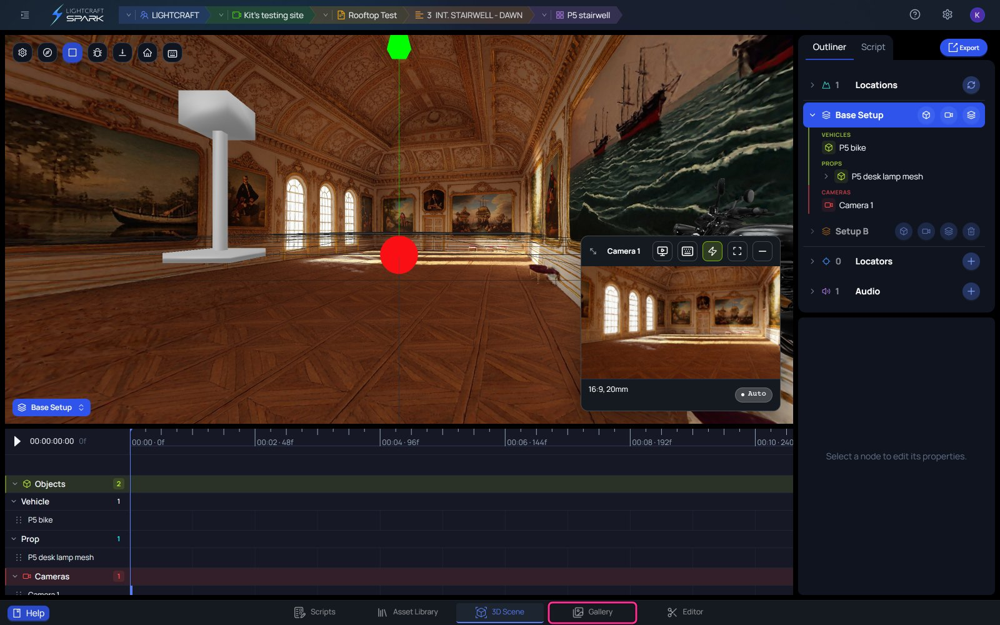

This is stage 5 of 5. After you [shoot takes](/spark/spark-ios/overview), you review them in the Gallery. Then you [cut them into an edit](/spark/editing/overview).

## Open the Gallery

Open a production, then click **Gallery** in the tabs at the bottom.

## Common tasks

| Task | Page |
|------|------|
| Tell a Take from a CG Take | [Browse and play takes](/spark/gallery/gallery#takes-and-cg-takes) |
| Generate a CG Take preview | [Render and download takes](/spark/gallery/render-and-download#generate-a-cg-take-preview) |
| Download takes | [Render and download takes](/spark/gallery/render-and-download#download-takes) |
| Collect takes in a list | [Share takes in lists](/spark/gallery/lists-and-sharing#create-and-edit-a-list) |
| Share a list with a link | [Share takes in lists](/spark/gallery/lists-and-sharing#share-a-list-with-a-link) |
