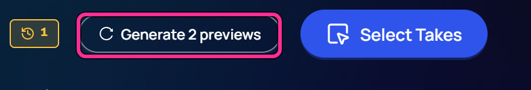
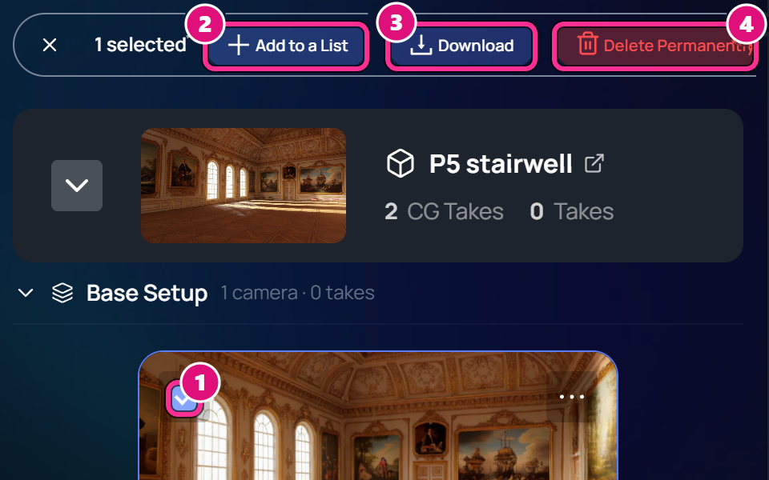

Each action is in the Gallery toolbar or on a card's **…** menu.

## Generate a CG Take preview

A new CG Take card reads **Generate preview** until it's rendered. When you change the 3D scene, older previews go out of date, and a yellow chip counts them.

1. In the toolbar, click **Generate N previews**. It renders the missing and out-of-date previews in the 3D scene.
2. Wait. Two previews took about 30 seconds. Each item shows its own progress: **Queued**, **Preparing…**, **Rendering 42%**, then **Saving…**.

To render one card again, hover it and click the round arrow beside its **CG TAKE** chip.

A preview can't be saved while your organization is out of storage, and the take keeps its old preview. See [Storage](/spark/scene-editor/asset-library#storage).

## Regenerate a background

A Take recorded with the iPhone's camera off has no CG background. On its card's **…** menu, click **Regenerate BG**. The browser renders the background from the take's camera track and shows **Regenerating BG — frame N of M**. The item shows its progress too, such as **Rendering BG 42%**.

It doesn't run on a take that already has a background, isn't linked to a 3D scene, or hasn't uploaded its camera track yet.

## Download takes

On a card's **…** menu, click **Download**. To download several, select them first. See [Select takes](#select-takes).

Every download is one zip named by date and time, such as `2026-10-29 20.05.04 Gallery Takes.zip`. Inside, folders go 3D scene, then setup, then camera. A CG Take is an MP4. A Take brings every layer file it has, with its tracking data.

## Select takes

1. In the toolbar, click **Select Takes**.
2. Tick the box on each card you want.
3. Pick what to do with them.

1. Select box
2. **Add to a List**
3. **Download**
4. **Delete Permanently**

## Delete a take

On the card's **…** menu, click **Delete permanently**, then confirm. Deleting a CG Take removes its camera animation and any camera moves recorded against it.

The window says if anything you delete is in a list or used in the Editor. It's removed from there too.

<Warning>
You can't undo a delete. Deleting a CG Take keeps the takes recorded on its camera. They stay in the Gallery, without a camera.
</Warning>

## Related

<CardGroup cols={2}>
  <Card title="Browse and play takes" icon="images" href="/spark/gallery/gallery">
    Find a take and play it.
  </Card>
  <Card title="Share takes in lists" icon="share-2" href="/spark/gallery/lists-and-sharing">
    Collect takes in a list and share its link.
  </Card>
</CardGroup>
