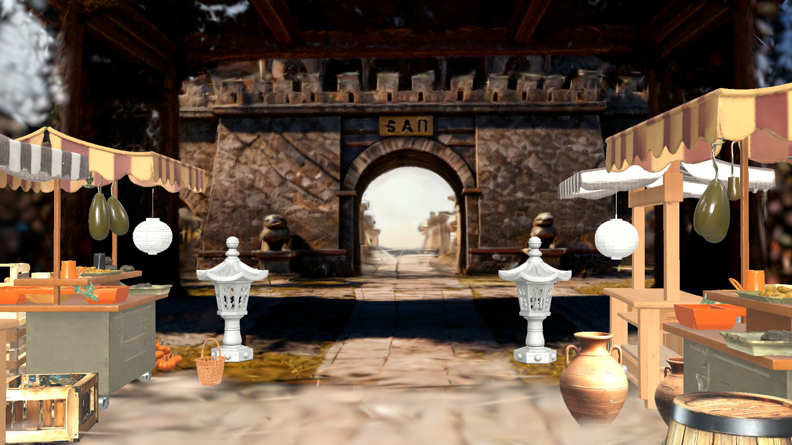

With the Spark plugin, [Claude Code](https://www.claude.com/product/claude-code) works in your Spark scenes for you. Describe what you want in plain words, and Claude places sets and props, adds cameras, animates them, and renders what a camera sees. Anyone with the scene open in the Spark web app sees the changes live.

## Prerequisites

- One of these, installed and signed in. Both work the same way:
  - [Claude Code](https://docs.claude.com/en/docs/claude-code/setup) in a terminal
  - [Claude Desktop](https://claude.com/download), in its **Code** tab, with a session that runs on your own computer
- A Mac with Apple silicon on macOS 15 or later, or a Windows 10 or 11 PC with a GPU and [Git for Windows](https://git-scm.com/downloads/win)
- A Spark production with at least one script. See [Quickstart](/spark/get-started/quickstart).

## Set up

1. Run these two commands in a terminal:

    ```bash
    claude plugin marketplace add https://github.com/LightcraftTechnology/spark-claude.git
    claude plugin install spark@lightcraft
    ```

2. Start a new Claude Code session, in a terminal or in Claude Desktop. The first one takes a minute or two while the plugin sets itself up.

3. Paste this prompt:

    ```text Starter prompt wrap
    Show me my Spark productions. Then make a new 3D scene in the one I pick, place one prop from the Library, add a 35 mm camera looking at it, and render what the camera sees.
    ```

The first time you ask for Spark work, your browser opens the Spark sign-in page. Sign in there, then return to Claude Code. Never type your Spark password into Claude Code.

## What to ask for

Claude is most useful for work that takes many repeated steps by hand. A single small change, such as moving one object, is faster to do yourself in the Spark web app.

Paste a scene's link from the Spark web app so Claude knows where to work. These jobs can take 20 minutes or more.

### Dress a set

Claude picks a location and props from the Library, sizes them, and arranges them.

```text Set dressing prompt wrap
Dress this scene as a busy market. Choose a location from the Library that fits, then place about 30 props that belong there: stalls, crates, barrels, lanterns, benches. Arrange them the way a real set would look, with clear paths for the actors. Add two cameras and render what each one sees. Show me your plan before you build it.
```

Claude placed 32 props in this scene and added both cameras:




### Animate complex movement

Claude writes hundreds of keys, so a move can have detail that is slow to key by hand: weaving, body roll, braking, and banking.

```text Animation prompt wrap
Animate a 12-second car chase with keyframes. A getaway car weaves through the set and takes a hard corner. A police car follows the same line one second behind and slides wide in the corner. Key both cars every 0.1 seconds, with body roll in the turns and the nose dipping under braking. Add one wide camera that keeps both cars in frame. Show me your plan before you build it.
```

Each car in this shot has 121 keys:

<video
  src="/images/spark/claude-code-chase.mp4"
  controls
  style={{ borderRadius: '0.5rem' }}
/>

### Add camera moves

Claude keys a camera the same way, so it can rise on a crane or follow a moving object.

```text Camera move prompt wrap
Animate a car driving in through the gate and across the set over 20 seconds. Add a slow crane shot that starts at wheel height as the car passes, then rises to show the whole set. Then add a second camera that follows the car from behind and to one side, swinging wide on the corner, with a handheld feel. Show me your plan before you build it.
```

The crane shot:

<video
  src="/images/spark/claude-code-crane-shot.mp4"
  controls
  style={{ borderRadius: '0.5rem' }}
/>

The follow camera:

<video
  src="/images/spark/claude-code-follow-camera.mp4"
  controls
  style={{ borderRadius: '0.5rem' }}
/>

## Limits

Claude cannot change lighting, create productions or scripts, or record takes. Renders use a fixed studio light. Create productions and scripts in the Spark web app, and record takes in the [Spark iOS app](/spark/spark-ios/spark-ios-setup).

Ask Claude to undo any change you don't want. Library assets it places stay in your production's files.

Library locations are sharp only near their centre. Keep the action and the cameras there.

## Update the plugin

Run this in a terminal, then start a new session:

```bash
claude plugin update spark@lightcraft
```

## Troubleshooting

- **Setup error when a session starts on Windows.** Install [Git for Windows](https://git-scm.com/downloads/win), then start a new session.
- **Renders fail on a Mac with Claude Code's sandbox turned on.** Follow the sandbox section of the [plugin's README](https://github.com/LightcraftTechnology/spark-claude#if-you-use-claude-codes-sandbox).
