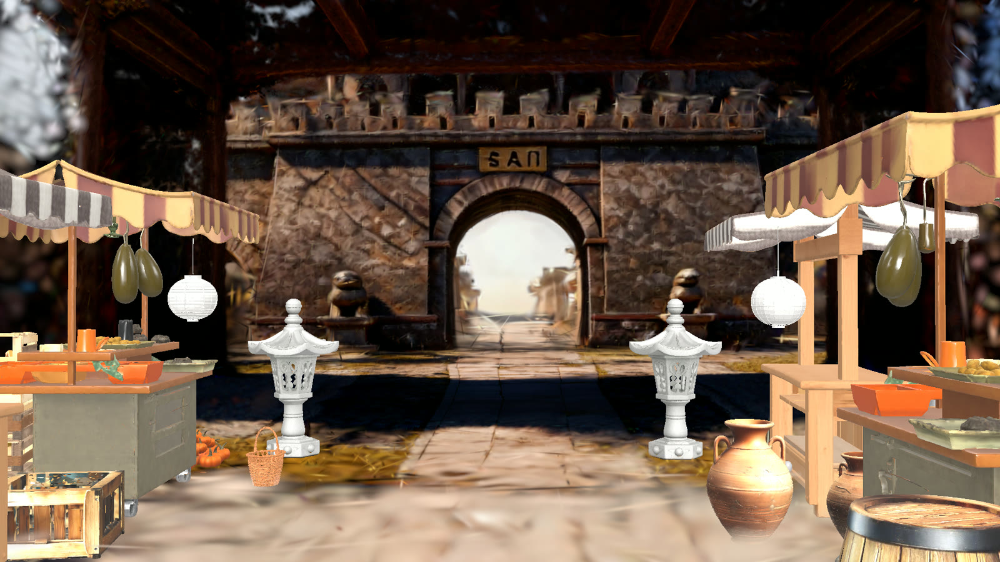

[Claude Code](https://www.claude.com/product/claude-code) places sets and props, animates cameras, and renders what a camera sees. By using your Spark account, Claude can only work in productions you can open.

## Prerequisites

- Claude Code installed and signed in, then run it on your own computer from either:
  - Your [terminal](https://docs.claude.com/en/docs/claude-code/setup)
  - The **Code** tab of [Claude Desktop](https://claude.com/download)
- System requirements:
  - Mac: Apple silicon, macOS 15 or later
  - Windows: Windows 10 or 11, an x64 processor, a GPU, [Git for Windows](https://git-scm.com/downloads/win)
- A Spark production with at least one script. See [Quickstart](/spark/get-started/quickstart).

## Set up

1. In a terminal, run:

    ```bash
    claude plugin marketplace add https://github.com/LightcraftTechnology/spark-claude.git
    claude plugin install spark@lightcraft
    ```

2. Start a new Claude Code session. The first one takes a minute or two to set up the plugin.

3. Paste this prompt:

    ```text Starter prompt wrap
    Show me my Spark productions. Then make a new 3D scene in the one I pick, place one prop from the Library, add a 35 mm camera looking at it, and render what the camera sees.
    ```

4. Your browser opens Spark. Sign in there, then return to Claude Code. Never type your Spark password into Claude Code.

## What to ask for

Claude suits jobs with many repeated steps, though big ones can take 20 minutes or more. For a small change, such as moving one object, working by hand is faster.

To start, paste a scene's link from the Spark web app so Claude knows where to work.

### Dress a set

```text Set dressing prompt wrap
Dress this scene as a busy market. Choose a location from the Library that fits, then place about 30 props that belong there: stalls, crates, barrels, lanterns, benches. Arrange them the way a real set would look, with clear paths for the actors. Add two cameras and render what each one sees. Show me your plan before you build it.
```

Claude placed 32 props and added both cameras:




### Animate complex movement

```text Animation prompt wrap
Animate a 12-second car chase with keyframes. A getaway car weaves through the set and takes a hard corner. A police car follows the same line one second behind and slides wide in the corner. Key both cars every 0.1 seconds, with body roll in the turns and the nose dipping under braking. Add one wide camera that keeps both cars in frame. Show me your plan before you build it.
```

Each car in this shot has 121 keyframes:

<video
  src="/images/spark/claude-code-chase.mp4"
  controls
  style={{ borderRadius: '0.5rem' }}
/>

### Add camera moves

```text Camera move prompt wrap
Animate a car driving in through the gate and across the set over 20 seconds. Add a slow crane shot that starts at wheel height as the car passes, then rises to show the whole set. Then add a second camera that follows the car from behind and to one side, swinging wide on the corner, with a handheld feel. Show me your plan before you build it.
```

The crane shot:

<video
  src="/images/spark/claude-code-crane-shot.mp4"
  controls
  style={{ borderRadius: '0.5rem' }}
/>

The follow camera:

<video
  src="/images/spark/claude-code-follow-camera.mp4"
  controls
  style={{ borderRadius: '0.5rem' }}
/>

## What Claude can do

- Place, move, scale and rotate objects in a 3D scene
- Place assets from your production's files or the Spark Library
- Make simple USD stand-ins, such as props and characters, then upload them
- Add cameras with real lenses, aim them and set focus
- Animate objects and cameras with keyframes
- Render a camera's view, check the frame and fix its own mistakes
- Render shot previews, then cut them into an edit with audio
- Pose the parts of an asset

<Note>
  Ask Claude to undo any change, such as "remove the props you just added". Undo leaves files behind: assets Claude placed or made stay in your production's files.
</Note>

## What Claude can't do

- Create organizations, productions or scripts. Use the Spark web app.
- Delete a scene. Use the Spark web app.
- Change lighting. Every render uses the same studio light.
- Record takes. Use the [Spark iOS app](/spark/spark-ios/spark-ios-app).
- Make new Gaussian splat locations. It uses the ones in your files and the Library.

## Update the plugin

Run this in a terminal, then start a new session:

```bash
claude plugin update spark@lightcraft
```

## Troubleshooting

- **Setup error when a session starts on Windows.** Install [Git for Windows](https://git-scm.com/downloads/win), then start a new session.
- **Renders fail on a Mac with Claude Code's sandbox on.** Follow the sandbox section of the [plugin's README](https://github.com/LightcraftTechnology/spark-claude#if-you-use-claude-codes-sandbox).
- **The ground or buildings look smeared.** Library locations are sharp only near their middle. Ask Claude to move the action and camera closer to the middle. If the scene needs more room, ask it to scale the location up.

## Related

<CardGroup cols={2}>
  <Card title="Quickstart" icon="rocket" href="/spark/get-started/quickstart">
    Make a production and a script for Claude to work in.
  </Card>
  <Card title="Asset Library" icon="library" href="/spark/scene-editor/asset-library">
    See the files Claude places and uploads.
  </Card>
</CardGroup>
