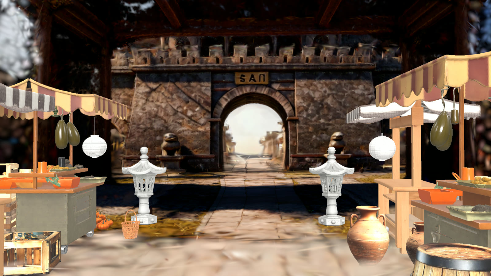

<Note>
  The examples on this page were created using **Claude Code**. Other AI agents and models can follow the same prompts.
</Note>

[Claude Code](https://www.claude.com/product/claude-code) places sets and props, animates cameras, and renders what a camera sees. By using your Spark account, Claude can only work in productions you can open.

## Prerequisites

- An AI agent installed on your computer and signed in, such as Claude Code in [Claude Desktop](https://claude.com/download) or a [terminal](https://code.claude.com/docs/en/terminal-guide).
- System requirements:
  - Mac: Apple silicon, macOS 15 or later
  - Windows: Windows 10 or 11, an x64 processor
- A Spark production with at least one script. See [Quickstart](/spark/get-started/quickstart).

<Note>
  Important: you need a coding agent installed on your computer. This guide will not work in claude.ai, chatgpt.com or similar browser chats.
</Note>

## Set up

To connect your agent to Spark, follow these steps:

<Steps titleSize="h3">
  <Step title="Open your agent">
    - In Claude Desktop, click the **Code** tab. Under the prompt box, choose **Local**, then any folder for Claude to work in.
    - In a terminal, type `claude`, then press **Enter**. If it asks to trust the folder, choose yes.
  </Step>
  <Step title="Give your agent the setup prompt">
    The install takes a minute or two.

    ```text Setup prompt wrap
    Set up Spark for me by following https://downloads.lightcraft.pro/sparkpy/start.md. You have my permission to download and run Spark's installer from https://downloads.lightcraft.pro/sparkpy/, and to run sparkpy login so I can sign in to Spark in my browser. Tell me what you are installing before you run anything, in clear, understandable words. When the install is done, tell me to start a new session.
    ```

    If your agent asks permission to run the installer, allow it.
  </Step>
  <Step title="Sign in and start a new session">
    Your browser will open Spark. Sign in there. Never type your password into the chat.

    When your agent suggests, start a new session: click **+ New** in Claude Desktop, or type `/exit`, then `claude` in a terminal.
  </Step>
  <Step title="Try your first prompt">
    In the new session, paste:

    ```text First prompt wrap
    Sign me in to Spark and suggest three simple scenes I could build.
    ```
  </Step>
</Steps>

## What to ask for

- Paste a scene's link from the Spark web app, so Claude knows where to work.
- Ask for a plan first. Each prompt below ends with "Show me your plan before you build it."
- Use Claude for jobs with many repeated steps. Big ones can take 20 minutes or more.
- Make small changes, such as moving one object, by hand. That's faster.

### Dress a set

```text Set dressing prompt wrap
Dress this scene as a busy market. Choose a location from the Library that fits, then place about 30 props that belong there: stalls, crates, barrels, lanterns, benches. Arrange them the way a real set would look, with clear paths for the actors. Add two cameras and render what each one sees. Show me your plan before you build it.
```

Claude placed 32 props and added both cameras:




### Animate complex movement

```text Animation prompt wrap
Animate a 12-second car chase with keyframes. A getaway car weaves through the set and takes a hard corner. A police car follows the same line one second behind and slides wide in the corner. Key both cars every 0.1 seconds, with body roll in the turns and the nose dipping under braking. Add one wide camera that keeps both cars in frame. Show me your plan before you build it.
```

Each car in this shot has 121 keyframes:

<video
  src="/images/spark/claude-code-chase.mp4"
  controls
  style={{ borderRadius: '0.5rem' }}
/>

### Add camera moves

```text Camera move prompt wrap
Animate a car driving in through the gate and across the set over 20 seconds. Add a slow crane shot that starts at wheel height as the car passes, then rises to show the whole set. Then add a second camera that follows the car from behind and to one side, swinging wide on the corner, with a handheld feel. Show me your plan before you build it.
```

The crane shot:

<video
  src="/images/spark/claude-code-crane-shot.mp4"
  controls
  style={{ borderRadius: '0.5rem' }}
/>

The follow camera:

<video
  src="/images/spark/claude-code-follow-camera.mp4"
  controls
  style={{ borderRadius: '0.5rem' }}
/>

## What Claude can do

- Place, move, scale and rotate objects in a 3D scene
- Place assets from your production's files or the Spark Library
- Make simple USD stand-ins, such as props and characters, then upload them
- Add cameras with real lenses, aim them and set focus
- Animate objects and cameras with keyframes
- Render a camera's view, check the frame and fix its own mistakes
- Render shot previews, then cut them into an edit with audio
- Pose the parts of an asset

<Note>
  Ask Claude to undo any change, such as "remove the props you just added". Undo leaves files behind: assets Claude placed or made stay in your production's files.
</Note>

## What Claude can't do

- Create organizations, productions or scripts. Use the Spark web app.
- Delete a scene. Use the Spark web app.
- Change lighting. Every render uses the same studio light.
- Record takes. Use the [Spark iOS app](/spark/spark-ios/spark-ios-app).
- Make new Gaussian splat locations. It uses the ones in your files and the Library.

## Update Spark

Give your agent the [setup prompt](#set-up) again, then start a new session. The installer updates Spark each time it runs.

## Troubleshooting

- **Your agent asks you to run a command yourself.** A safety check blocked the installer or the sign-in. Paste the whole [setup prompt](#set-up) again, including the sentence that gives permission.
- **The ground or buildings look smeared.** Library locations are sharp only near their middle. Ask Claude to move the action and camera closer to the middle. If the scene needs more room, ask it to scale the location up.

## Related

<CardGroup cols={2}>
  <Card title="Quickstart" icon="rocket" href="/spark/get-started/quickstart">
    Make a production and a script for Claude to work in.
  </Card>
  <Card title="Asset Library" icon="library" href="/spark/scene-editor/asset-library">
    See the files Claude places and uploads.
  </Card>
</CardGroup>
