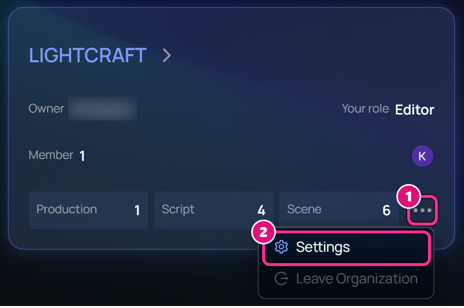

Do this before stage 1 of 5.

## Open Organization Settings

On the Home page, click **⋯** on the organization's card, then **Settings**.

1. **⋯**
2. **Settings**

## Common tasks

| Task | Page |
|------|------|
| Create an organization | [Organizations](/spark/organizations-productions/organizations#create-an-organization) |
| Invite a member | [Members and seats](/spark/organizations-productions/members-and-seats#invite-a-member) |
| Change a member's access | [Members and seats](/spark/organizations-productions/members-and-seats#change-a-members-access) |
| Check seats and billing | [Members and seats](/spark/organizations-productions/members-and-seats#seats-and-billing) |
| Create a production | [Productions](/spark/organizations-productions/productions#create-a-production) |
| Set who can open a production | [Productions](/spark/organizations-productions/productions#set-who-can-open-a-production) |
