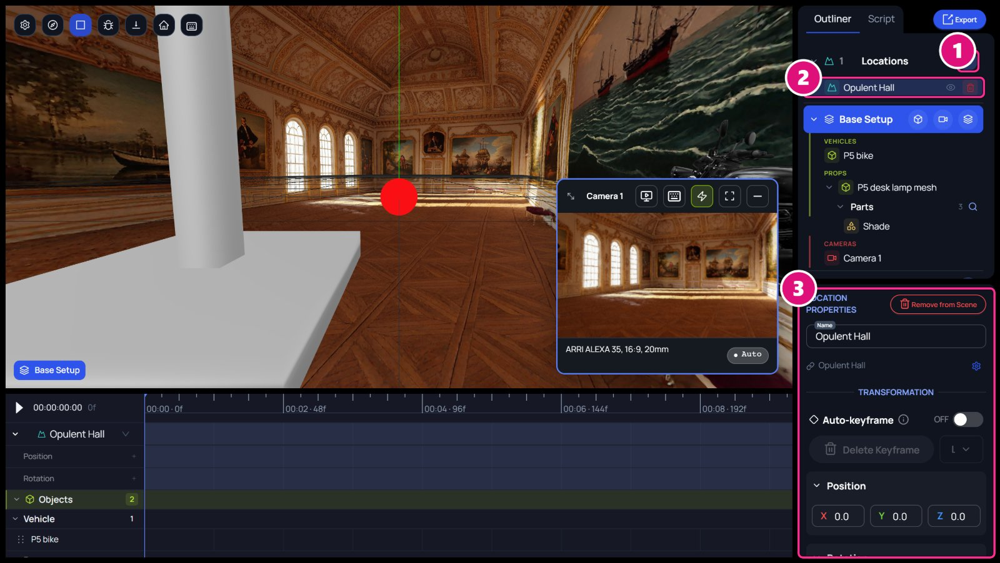
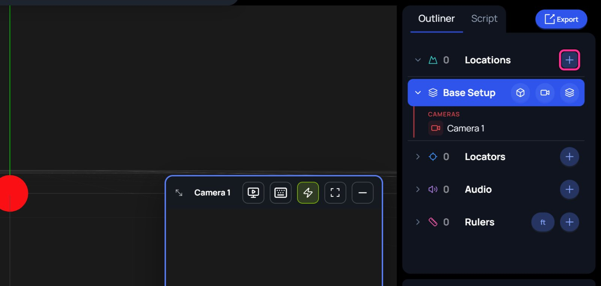
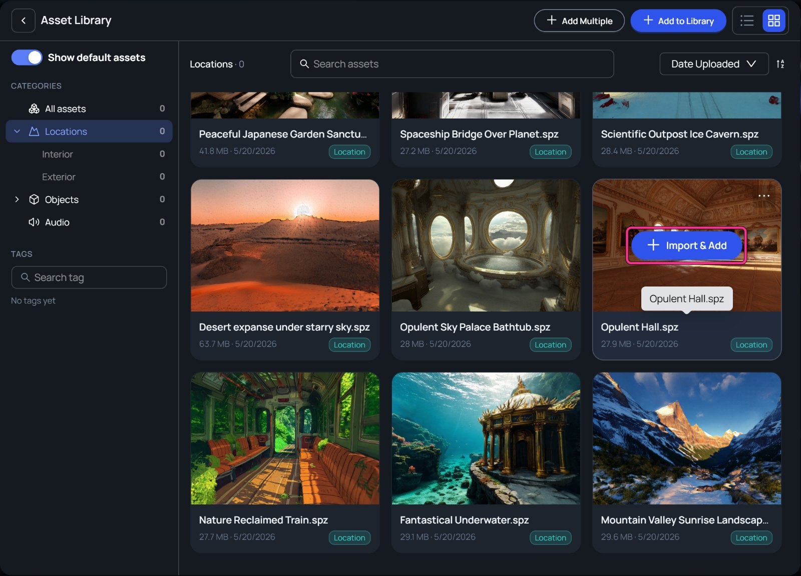
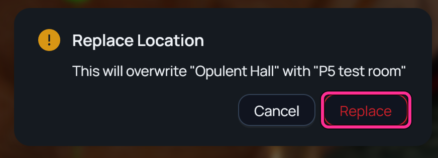
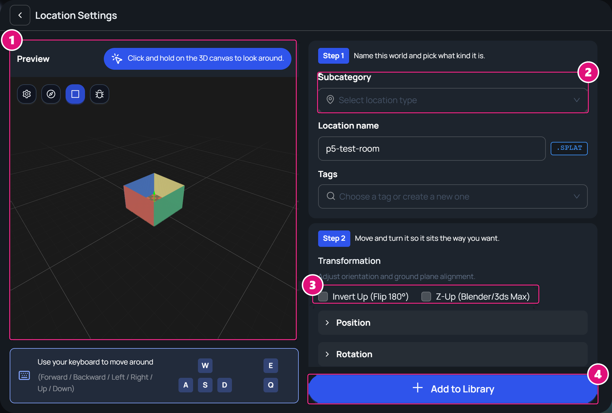
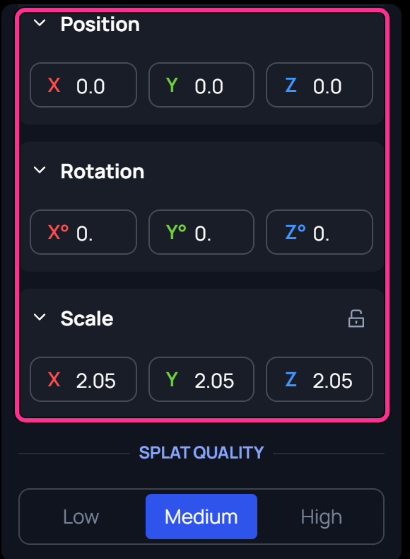
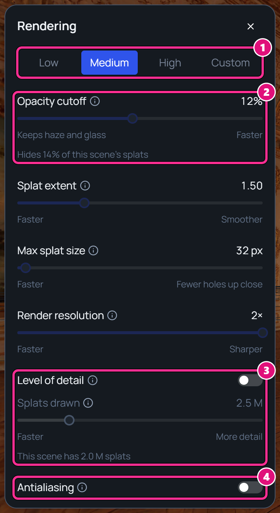
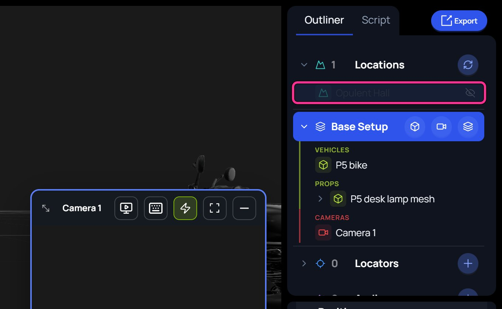

A location is usually a Gaussian splat scan. Each 3D scene holds one location, and every setup in it shares that location.

1. **Replace location**
2. Location row: eye, trash
3. **Location Properties**

## Add a location

<Steps titleSize="h3">
  <Step title="Open the location library">
    In the Outliner, click **+** on the **Locations** row.

    
  </Step>
  <Step title="Add a location">
    Hover a location, then click **Add to Scene**. A default location you haven't used yet says **Import & Add**. To use your own file, click **Add to Library** first. See [Location Settings](#location-settings).

    
  </Step>
  <Step title="Wait for it to load">
    The location's row shows in the Outliner within seconds. The splat itself can take about 30 seconds to render.
  </Step>
</Steps>

## Replace a location

Once a scene has a location, the **+** on the **Locations** row becomes **Replace location** (↻). Click it, pick another location, then click **Replace** to confirm.

<Note>
  The camera preview can keep showing the old location for a minute or more. The 3D canvas shows the new one.
</Note>

## Location Settings

**Location Settings** opens when you upload a location with **Add to Library**. It takes a splat or a USD set: `.ply`, `.splat`, `.spz`, `.usd`, `.usdc`, `.usda` or `.usdz`.

1. **Preview**
2. **Subcategory**
3. **Invert Up** and **Z-Up**
4. **Add to Library**

- In the **Preview**, drag to look around, and use **W**, **A**, **S**, **D**, **Q** and **E** to move.
- **Subcategory** is required: **Interior** or **Exterior**.
- Tick **Invert Up (Flip 180°)** or **Z-Up (Blender/3ds Max)** if the location loads upside down or on its side.

Step 3 of the window sets the scale. Add the human figure to check that the world is the right size. If you leave the scale as it is, Spark asks **Scale hasn't been adjusted. Are you sure it's right?**

## Fix orientation or scale

Select the location, then change **Position**, **Rotation** or **Scale** under **Transformation** in **Location Properties**. **Scale** has a lock beside it.

## Set the render quality

The **Rendering** panel sets how splats are drawn. Open it in one of two ways:

- Click **Settings** (the gear) in the canvas toolbar, then **Rendering…**.
- Select a splat location, then click **Render quality settings** under **Rendering** in its properties.

The panel opens under the toolbar, and you can keep working in the scene. To close it, click **X** or press **Esc**.

1. Presets
2. **Opacity cutoff**
3. **Level of detail**, **Splats drawn**
4. **Antialiasing**

- Under **Opacity cutoff**, a line gives the share of the scene's splats this setting hides. It turns amber above the **Low** preset's value.
- Under **Splats drawn**, Spark shows the scene's splat count. With **Level of detail** on, it also says how many of those it draws.

A preset sets every value at once. **Medium** is the default.

| Setting | Low | Medium | High |
|---------|-----|--------|------|
| **Opacity cutoff** | 20% | 12% | 3.9% |
| **Splat extent** | 1.00 | 1.50 | 2.50 |
| **Max splat size** | 16 px | 32 px | 128 px |

Every preset sets **Render resolution** to 2×, with **Level of detail** and **Antialiasing** off.

Move any slider or switch, and the preset becomes **Custom**. Your choice stays after a reload, and applies to every scene on this device. Exports and upload thumbnails always use the **High** values.

| Setting | What it does |
|---------|--------------|
| **Opacity cutoff** | Splats fainter than this aren't drawn. Too high, and clouds, haze and glass disappear. |
| **Splat extent** | How far each splat's soft edge reaches. |
| **Max splat size** | The largest one splat can get on screen. Too low leaves holes in near surfaces, such as foliage. |
| **Render resolution** | The highest pixel ratio the canvas renders at. It never goes above your screen's own. |
| **Level of detail** | On, Spark draws a lighter version of large locations. Off, it draws every splat the other settings allow. |
| **Splats drawn** | The most splats **Level of detail** draws each frame, across all locations. Spark draws fewer when the view already has enough detail. |
| **Antialiasing** | Smooths the edges of models and the grid. Splats look the same either way, but large splat scenes get much slower. |

A change to **Antialiasing** takes effect after a reload. The panel shows **Takes effect after a reload.** Click **Reload now** to reload the page.

## Hide a location

Hover the location's row, then click the eye. The location disappears from the 3D canvas and the camera preview, and the row turns dim.

To take the location out of the scene, click **Remove from Scene** in **Location Properties**.

## Related

<CardGroup cols={3}>
  <Card title="Asset Library" icon="library" href="/spark/scene-editor/asset-library">
    Upload your own locations.
  </Card>
  <Card title="Move around a scene" icon="move-3d" href="/spark/scene-editor/move-around-a-scene">
    See the floor plan with Top-Down View.
  </Card>
  <Card title="Bring in an Unreal scene" icon="import" href="/spark/scene-editor/importing-unreal-scenes">
    Make a location from Unreal Engine.
  </Card>
</CardGroup>
