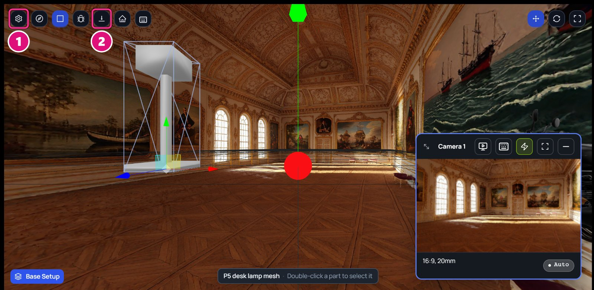
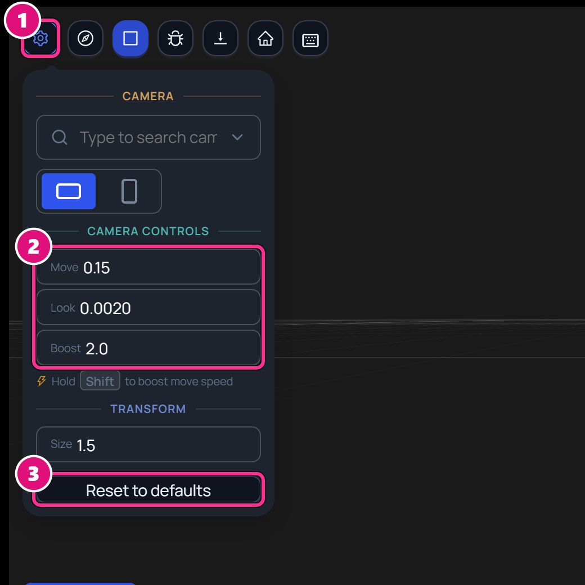
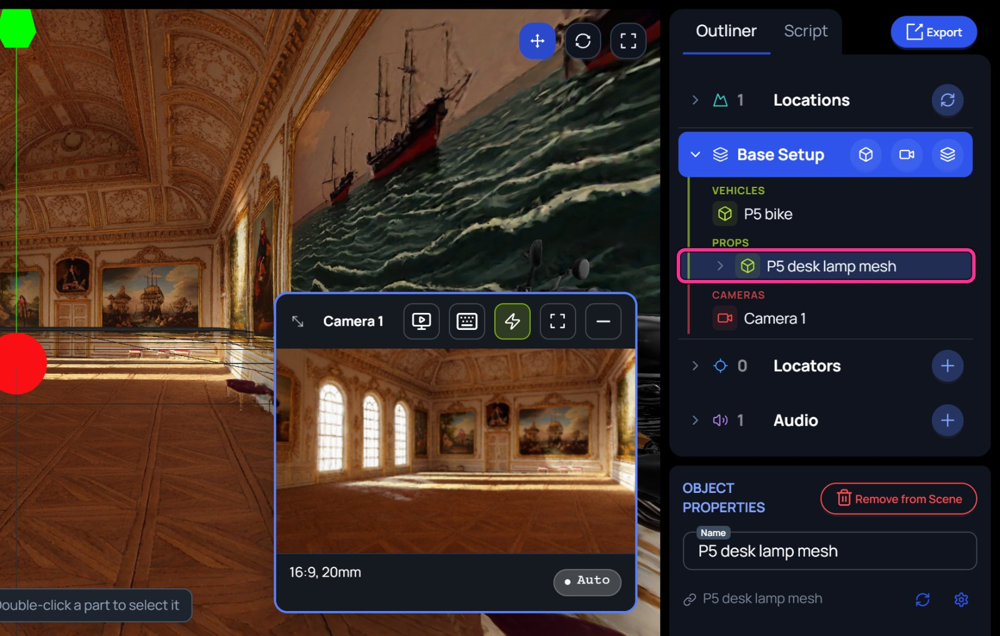
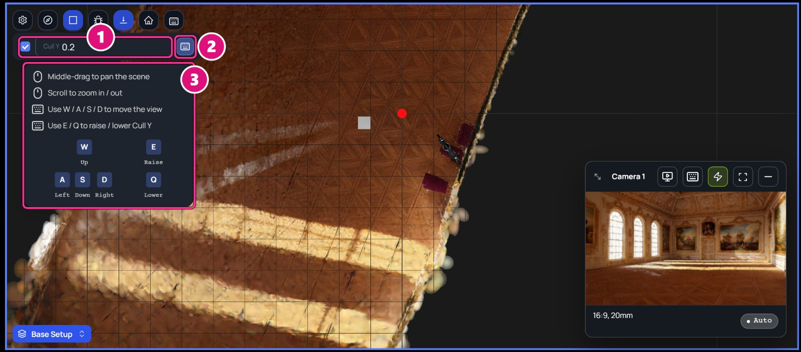

You move through the 3D canvas in fly mode, like a first-person camera: keys move you, and dragging turns your view. Click the canvas first, so it takes your key presses. See [Choose which view the keys move](/spark/scene-editor/scene-editor#choose-which-view-the-keys-move).

1. **Settings**
2. **Top-Down View**

## Fly through a 3D scene

| To | Do this |
|----|---------|
| Move forward, back, left or right | **W**, **S**, **A**, **D** |
| Move up or down | **E**, **Q** |
| Move faster | Hold **Shift** while you move |
| Look around | Drag on the canvas |
| Move forward or back in steps | Scroll |
| Jump to the selection | **F** |
| Orbit what you jumped to | Hold **F** and drag |

To change how fast you fly, click **Settings** (the gear) in the canvas toolbar, then **Camera & controls**.

1. **Settings**
2. **Move**, **Look**, **Boost**
3. **Reset to defaults**

- **Move** sets how fast the keys move you.
- **Look** sets how fast dragging turns the view.
- **Boost** sets how much faster you move while you hold **Shift**.

**Reset to defaults** puts all three back. The defaults are **Move** 0.15, **Look** 0.0020 and **Boost** 2.0.

## Select an item

Click the item's row in the Outliner. Its settings open in the Properties panel.

- **Shift**+click adds another item to the selection.
- **Esc** clears the selection.
- Double-click an object on the canvas to select one of its parts. See [Parts of an object](/spark/scene-editor/parts-of-an-object).

## Jump to the selection

Select a camera, a locator, an object or a part, then press **F**. You can also click **Jump to** at the top of its Properties panel. The view jumps there at once.

| Selection | Where the view goes |
|-----------|---------------------|
| Camera | To the camera's eye, at the playhead. The camera doesn't move, and no keyframe is added. |
| Locator | 1.6 units above the locator, facing the way its arrow points. |
| Object or part | The view keeps its direction and backs off until the whole item fits. |

After **F** frames an object or a part, keep **F** held and drag. The view orbits around the middle of what you framed. Let go of **F** or the mouse button to stop.

A jump moves your view, not the scene, so **Ctrl+Z** doesn't undo it.

The view doesn't jump in these cases:

- In Top-Down View, or while the camera preview is full screen, **Jump to** is grayed out.
- For a hidden object, it shows **It's hidden — show it to jump to it**.
- For an object still loading, it shows **Nothing to jump to yet — it's still loading**.
- **F** does nothing for a location, a splat or a ruler.

## Top-Down View

Click **Top-Down View** to look straight down on the scene. Middle-drag to pan, scroll to zoom, and use **W**, **A**, **S**, **D** to move.

1. **Cull Y**
2. **Controls**
3. Top-down controls

**Cull Y** cuts away everything above a height, so you see the floor plan instead of the ceiling. It cuts splats and USD objects at the same height. Cameras above the cut are hidden too, but their names still show.

- Drag the value or type a height.
- Click the canvas, then press **E** to raise the cut and **Q** to lower it, by 0.5 each time.
- Untick the box to see the whole scene. Tick it again to go back to the last height.
- **Reset view** centers the view again and keeps the **Cull Y** height.

## Related

<CardGroup cols={2}>
  <Card title="Scene editor" icon="layout-panel-left" href="/spark/scene-editor/scene-editor">
    The canvas toolbar and the panels around it.
  </Card>
  <Card title="Objects" icon="box" href="/spark/scene-editor/objects">
    Move, rotate or scale what you selected.
  </Card>
</CardGroup>
