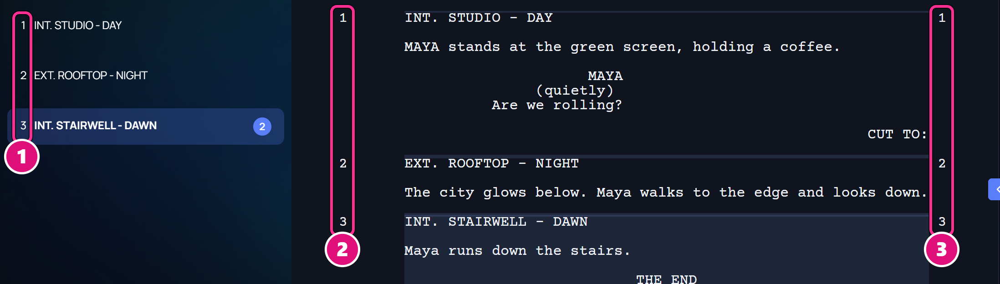
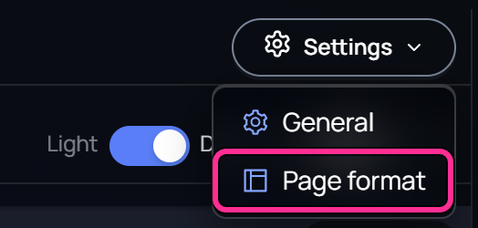
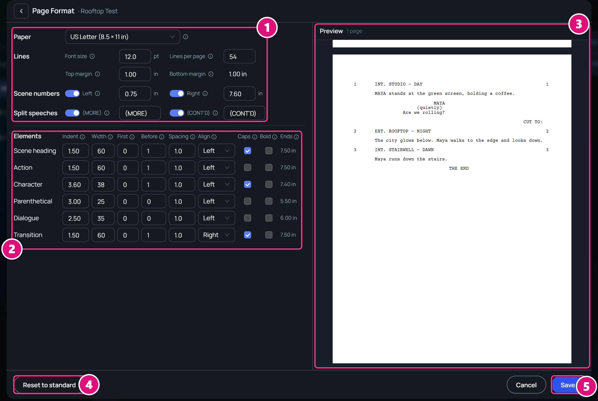

Spark numbers every scene heading and lays a script out as pages. Each script keeps its own page format.

## Scene numbers

Every scene heading has a number. Spark uses the number typed in the heading, such as `#12A#`. A heading with no number takes its position in the script.

1. Number column
2. Left margin
3. Right margin

- **View**, **Edit**, **Compare** and the PDF show the number in both margins.
- Every list of scene headings starts with the number, such as **Script scenes**.
- **Search** finds a script scene by its number.
- A Final Draft file keeps its scene numbers when you upload it.

Changing only a number isn't a heading change when you publish, so the 3D scenes stay with their script scene.

## Pages

**View**, **Edit** and the PDF show the same pages.

- A script's title page comes first.
- Each sheet is the paper size the format sets.
- Page numbers start on page 2.
- A speech cut by a page break ends with **(MORE)**. It picks up on the next page under the character's name and **(CONT'D)**.

## Set the page format

<Steps titleSize="h3">
  <Step title="Open Page format">
    On the script page, click **Settings**, then **Page format**.

    

    On the **Scripts** tab, **⋯** on a script's row also has **Page format**.
  </Step>
  <Step title="Change the values">
    **Preview** lays the script out again as you type, and shows the page count.

    

    

    1. Page settings
    2. **Elements**
    3. **Preview**
    4. **Reset to standard**
    5. **Save**

    

  </Step>
  <Step title="Save it">
    Click **Save**. If a value doesn't fit the paper, fix it first.
  </Step>
</Steps>

| Setting | What it does |
|---------|--------------|
| **Paper** | The sheet the pages are laid out on, and the page size of the PDF: US Letter, A4, US Legal or **Custom**. |
| **Font size** | The size of the Courier type, in points. |
| **Lines per page** | How many lines a page holds, blank lines included. |
| **Top margin** | The space above a page's first line. The page number sits in it. |
| **Scene numbers** | Where the **Left** and **Right** numbers start, in inches from the paper's left edge. Switch a side off to leave it out. |
| **Split speeches** | The **(MORE)** and **(CONT'D)** labels. Switch one off to leave it out. |

**Bottom margin** follows from the other values.

Each row under **Elements** sets one screenplay element, from **Scene heading** to **Transition**.

| Column | What it sets |
|--------|--------------|
| **Indent** | Where the lines start, in inches from the paper's left edge. |
| **Width** | The most characters a line holds before it wraps. |
| **First** | How many characters the first line moves by. |
| **Before** | Blank lines above each new element of this kind. |
| **Spacing** | Line spacing: 1 is single, 2 is double. |
| **Align** | Where the lines sit within the width. |
| **Caps** and **Bold** | Show the element in capitals or in bold. |

**Ends** shows where a full line ends. It has to stay on the paper.

## Keep an uploaded file's format

When you upload a PDF or a Final Draft file, Spark saves its page format with the script. A newer version you import brings its own format, which applies when you publish it.

- **Reset to imported** fills in the format of the uploaded file. It shows only for a script that has one.
- **Reset to standard** fills in Spark's standard format.

Neither changes the script until you click **Save**.

## Related

<CardGroup cols={2}>
  <Card title="Script editor" icon="pencil" href="/spark/scripts/script-editor">
    Write and format a script.
  </Card>
  <Card title="Drafts and versions" icon="history" href="/spark/scripts/versioning">
    Publish edits and import newer versions.
  </Card>
</CardGroup>
