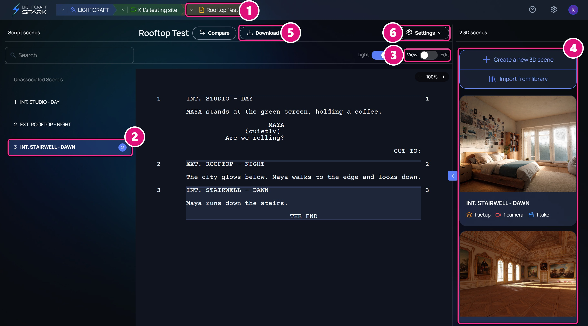
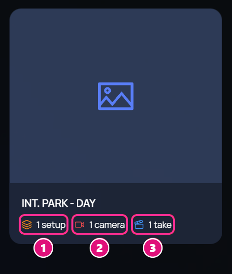
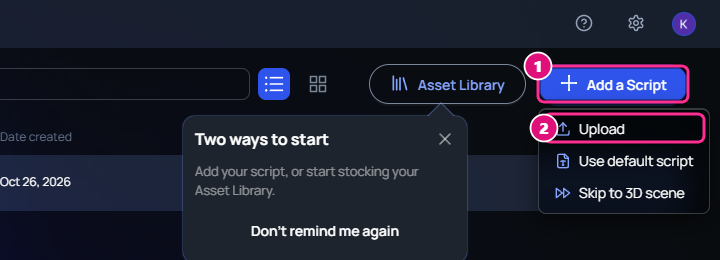
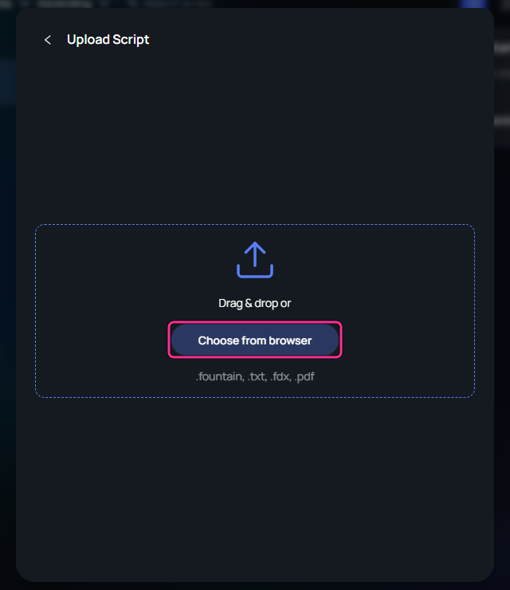
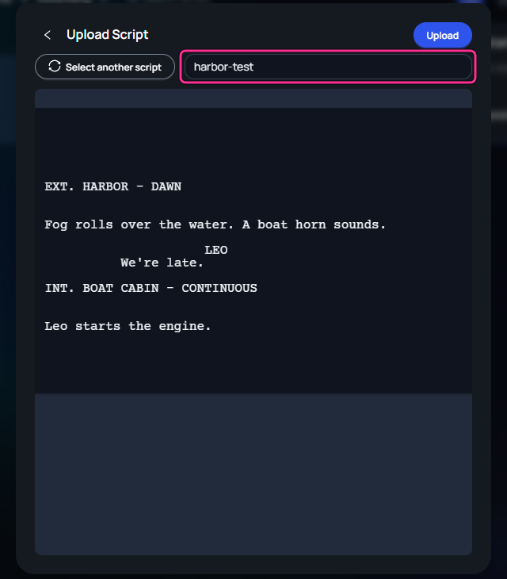
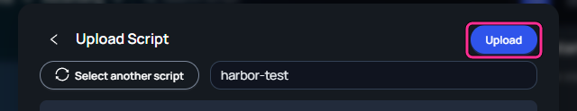
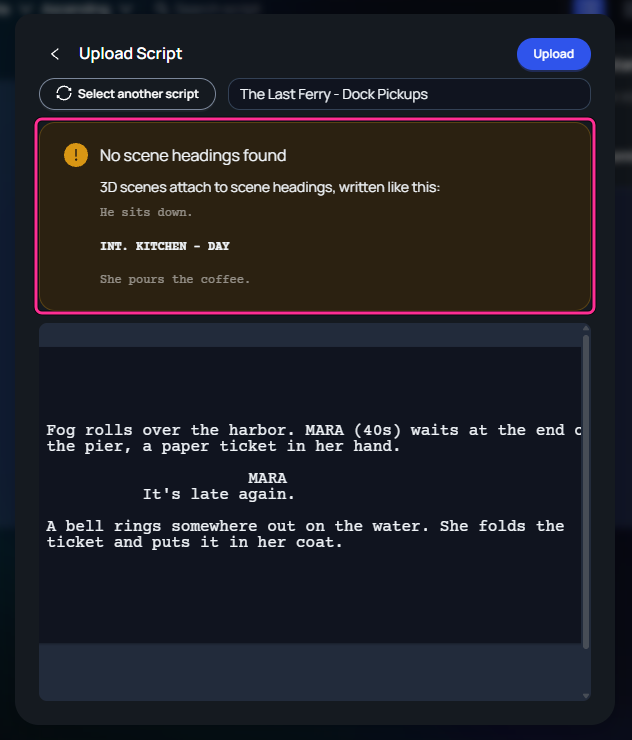
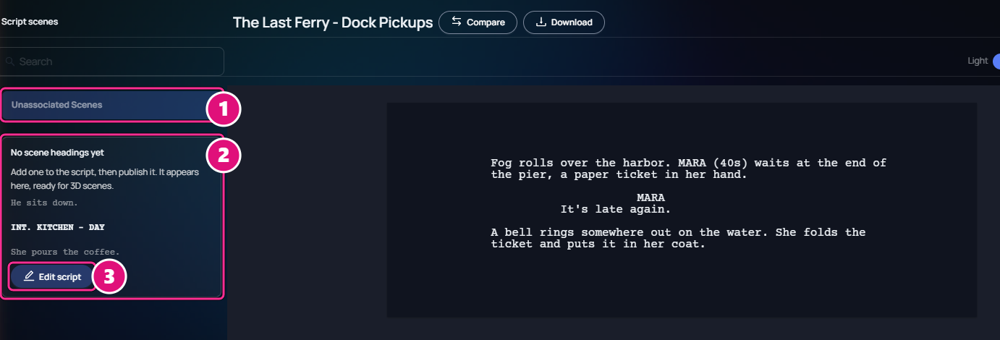
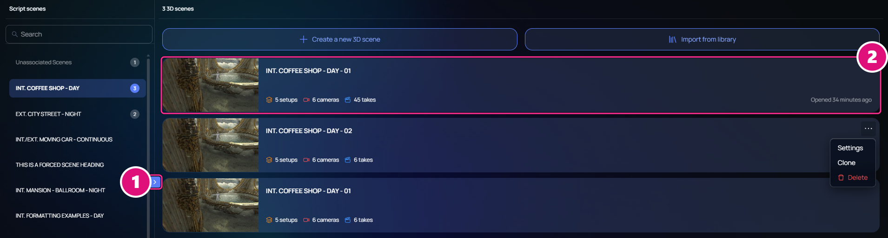

A production can hold several scripts. Every scene heading in a script becomes a script scene, and each script scene holds the 3D scenes you build for it.

1. Script switcher
2. Script scene, with its number and 3D scene count
3. **View** and **Edit**
4. 3D scenes, with **Create a new 3D scene**
5. **Download**: Fountain or PDF
6. **Settings**: **General** and **Page format**

- Click the switcher's arrow to open another script in this production.
- For **View** and **Edit**, see [Script editor](/spark/scripts/script-editor).
- For scene numbers and **Page format**, see [Scene numbers and page format](/spark/scripts/page-format).

## Scripts, script scenes and 3D scenes

Spark uses four terms that sound alike. Each one names a different thing.

| Term | What it is |
|------|------------|
| Script | A screenplay in a production. Spark keeps it in Fountain format. |
| Script scene | One scene heading in the script, such as `INT. STUDIO - DAY`. |
| 3D scene | A set you build for a script scene. A script scene can hold several. |
| Scene editor | The **3D Scene** tab, where you build a 3D scene. |

Scene headings don't make 3D scenes on their own. Each script scene starts with none, and you add each 3D scene with **Create a new 3D scene**. Spark names it after the script scene.

1. **Setups**
2. **Cameras**
3. **Takes**

Setups include the Base Setup, and cameras count across all setups. Takes are one CG Take for each camera, plus any takes you record.

## Add a script

On the production's **Scripts** tab, click **Add a Script**. Pick one of these options.

| Choice | What it does |
|--------|--------------|
| **Upload** | Brings in a `.fountain`, `.txt`, `.fdx` or `.pdf` file. |
| **Use default script** | Adds the Fountain Syntax Guide, a sample script that shows every screenplay element. It opens in Edit, ready to write. |
| **Skip to 3D scene** | Adds an empty script with one 3D scene, and opens that 3D scene in the scene editor. |
| **Start from a library scene** | Copies a scene from the scene library into a new script. See [Start from a library scene](/spark/scene-editor/3d-scenes#start-from-a-library-scene). |

To upload a file:

<Steps titleSize="h3">
  <Step title="Choose the file">
    Click **Add a Script**, then **Upload**. Drag your file into the window, or click **Choose from browser**.

    

    

    1. **Add a Script**
    2. **Upload**

    

    
  </Step>
  <Step title="Check the preview">
    Spark shows the script as it will read.

    
  </Step>
  <Step title="Upload it">
    Click **Upload**. The script appears in the list.

    
  </Step>
</Steps>

If the file has a title page, Spark names the script after its `Title:` line. Otherwise the script takes the file's name. Spark turns a PDF into Fountain when you upload it.

## Scripts with no scene headings

3D scenes attach to scene headings, such as `INT. KITCHEN - DAY`. If a file has none, the upload preview warns **No scene headings found**. **Upload** still works.

The script page then lists **Unassociated Scenes**, with a **No scene headings yet** box. You can build 3D scenes there until the script has a heading.

1. **Unassociated Scenes**
2. **No scene headings yet**
3. **Edit script**

Add a heading and publish the script. The box goes away, and the heading joins **Script scenes**.

## Jump to a script scene

Click a heading under **Script scenes**. Spark highlights that scene in the script, and the 3D scene list shows its 3D scenes. To find a heading in a long script, enter part of it, or its scene number, in **Search**.

To give the 3D scenes more room, click the arrow on the left edge of the 3D scene list. The script collapses, and each 3D scene shows as a row with its setups, cameras and takes.

1. Collapse or expand the script
2. 3D scene row

Point at a row to open its **…** menu.

## Switch between scripts

In the breadcrumb at the top, click the arrow beside the script's name, then pick another script. The **Scripts** tab also lists every script, with how many 3D scenes each holds.

## Rename or delete a script

On the **Scripts** tab, click **⋯** at the end of the script's row.

- To rename, click **Settings**, change **Title**, then click **Save**. On the script page, **Settings** then **General** opens the same window.
- To delete, click **Delete**, then **Delete** again to confirm.

<Warning>
  Deleting a script also deletes its 3D scenes, cameras and takes, for good.
</Warning>

## Related

<CardGroup cols={3}>
  <Card title="Script editor" icon="pencil" href="/spark/scripts/script-editor">
    Write and format the script.
  </Card>
  <Card title="Drafts and versions" icon="history" href="/spark/scripts/versioning">
    Publish edits and bring in a newer draft.
  </Card>
  <Card title="3D scenes" icon="box" href="/spark/scene-editor/3d-scenes">
    Open the 3D scenes of a script scene.
  </Card>
</CardGroup>
