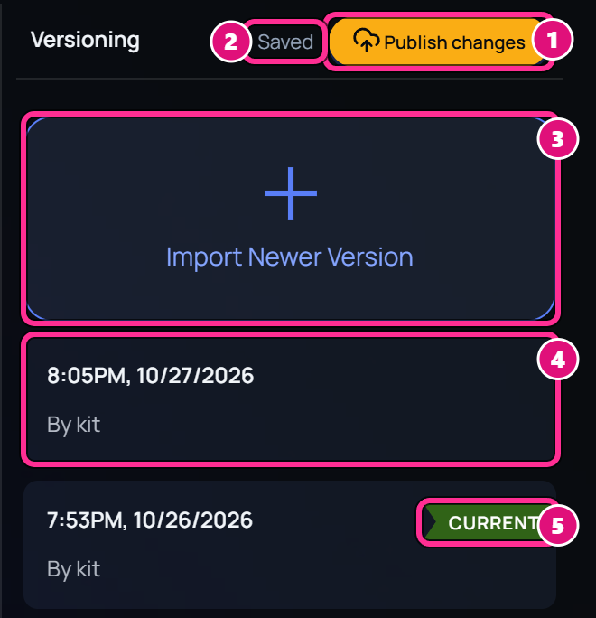
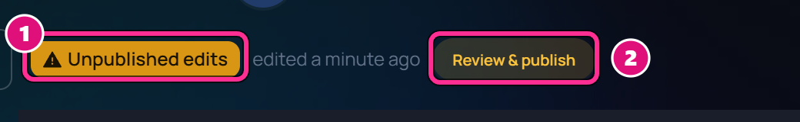
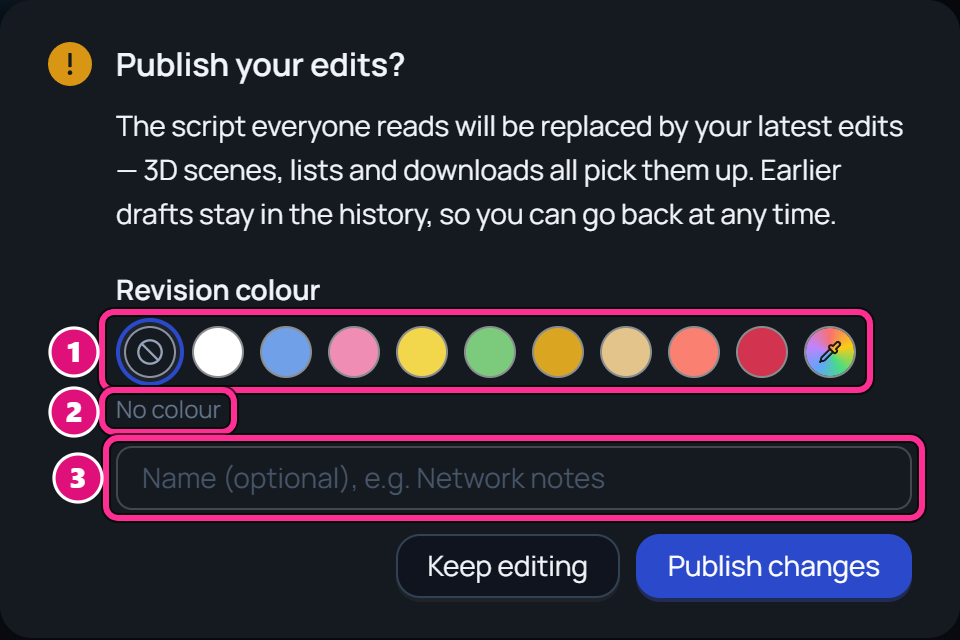
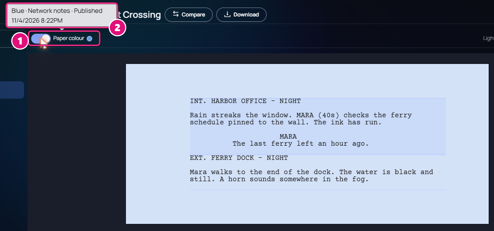
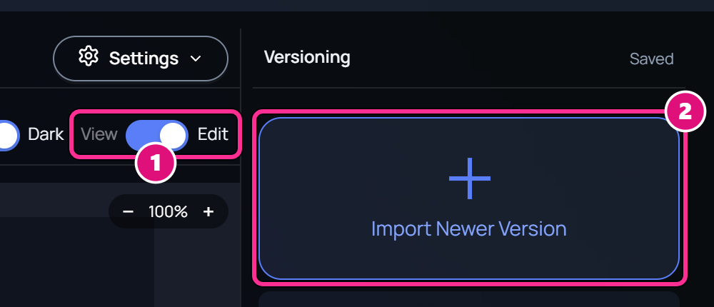
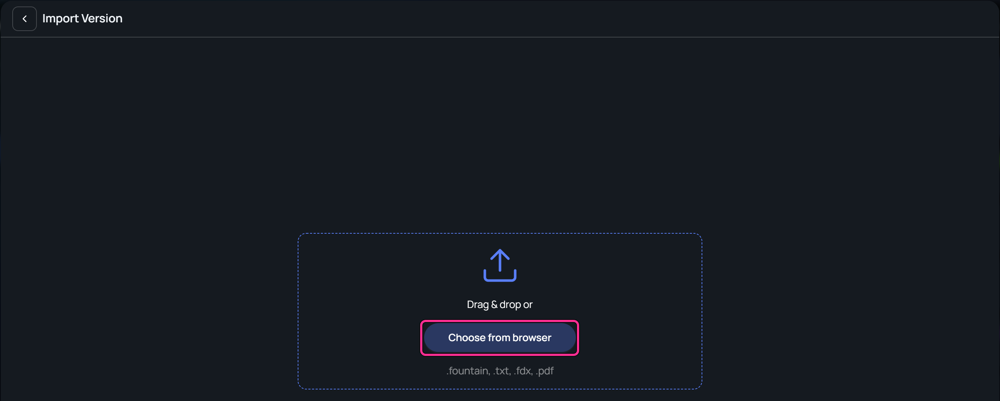
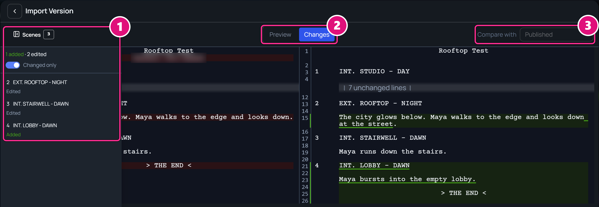
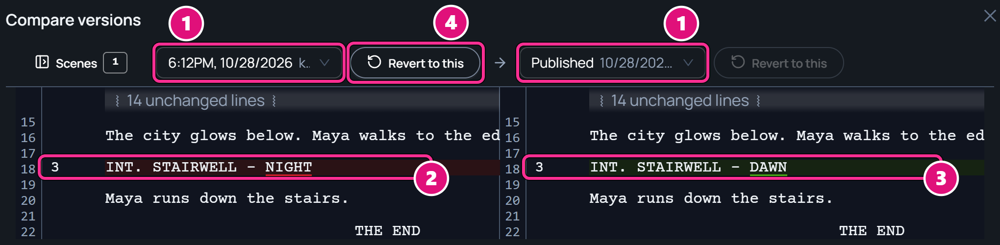
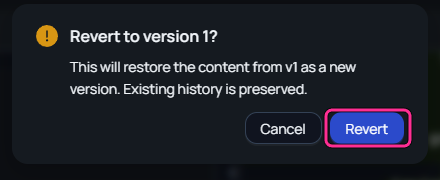

Every edit saves as a draft version that only you see. The team reads the published version until you publish your draft.

1. **Publish changes**
2. Save status
3. **Import Newer Version**
4. Version: time, author
5. **CURRENT**

- **CURRENT** marks the published version that everyone reads. **PUBLISHED** marks an earlier publish, and **IMPORTED** a version that came from a file.
- For the save status, see [Script editor](/spark/scripts/script-editor#view-and-edit).

## The Versioning column

To see it, switch the script to **Edit** or press **Ctrl+E** (**Cmd+E** on a Mac). It lists every version of the script, newest first.

Your saves share one card until you pause for 5 minutes, and the card counts them, such as **8 saves**. A run of saves with no pause starts a new card after 30 minutes.

A published card shows a stripe in its revision color, the revision's name, and who published it. 3D scenes, lists and downloads use the current version.

## Publish your edits

<Steps titleSize="h3">
  <Step title="Open your draft">
    In View mode, a draft shows as **Unpublished edits**. Click **Review & publish** to open it in Edit mode.

    

    

    1. **Unpublished edits**
    2. **Review & publish**

    

  </Step>
  <Step title="Pick a color and a name">
    Click **Publish changes**. Optional: in **Publish your edits?**, click a **Revision color** and enter a name, such as `Network notes`.

    

    

    1. **Revision color**
    2. Color Spark picks
    3. Name

    

  </Step>
  <Step title="Publish it">
    Click **Publish changes**. Spark shows **Changes published — everyone sees them now**.
  </Step>
</Steps>

Your draft becomes the current version. New scene headings join **Script scenes**, and the earlier versions stay in the list.

## Revision colors

Colors follow the standard order for script revisions: White, Blue, Pink, Yellow, Green, Goldenrod, Buff, Salmon and Cherry. When the order starts again, the name says so, such as **Double White**.

- The window starts on **No color** until the script has a colored publish. After that, it starts on the next color in the order.
- **Your own color**, the last swatch, opens a color picker.

When the current version has a color, a **Paper color** switch sits at the left of the toolbar. It tints the page in that color and is on unless you turn it off.

1. **Paper color**
2. Revision name and publish date

## Import a newer version

Use this when a new draft arrives from your screenwriting app. It adds the file as a new version, so the script keeps its history.

<Steps titleSize="h3">
  <Step title="Open the Versioning column">
    Switch the script to **Edit**, then click **Import Newer Version**.

    

    

    1. **Edit**
    2. **Import Newer Version**

    

  </Step>
  <Step title="Choose the file">
    Drag in a `.fountain`, `.txt`, `.fdx` or `.pdf` file. You can also click **Choose from browser**. A file with no scene headings shows a warning first.

    
  </Step>
  <Step title="Check the changes">
    The review opens on **Preview**, the file's own pages. **Changes** sets the file beside the published version, or beside your latest draft if you have unpublished edits. **Compare with** picks another version.

    **Scenes** lists the scenes that changed, each marked **Added**, **Removed**, **Edited**, **Renamed** or **Moved**. Click one to jump to it. Turn off **Changed only** to list every scene.

    

    

    1. **Scenes**
    2. **Preview** and **Changes**
    3. **Compare with**

    

  </Step>
  <Step title="Import and publish">
    Click **Import** at the bottom right. The file becomes a draft marked **IMPORTED**. Publish it as you would any edit.

    To pick another file instead, click **Back**. Nothing is saved until you click **Import**.
  </Step>
</Steps>

## Compare two versions

Click **Compare** in the title bar to see what changed since the last publish. To compare a version with the one before it, click its card in the **Versioning** column.

In **Compare versions**, pick a version on each side. The older one shows in red and the newer one in green, whichever side it's on.

1. Version pickers, with **Published** and **Drafts**
2. Older version
3. Newer version
4. **Revert to this**

Click **Scenes** at the top left to list the scenes that changed, as in the import review. Click a scene to jump to it.

## Go back to an earlier version

<Steps titleSize="h3">
  <Step title="Open the version">
    Click **Compare**, then pick the version you want on the older side.
  </Step>
  <Step title="Revert to it">
    Click **Revert to this** on the older side, then **Revert**. Spark saves it as a new draft.

    
  </Step>
  <Step title="Publish it">
    Click **Publish changes** to make it the current version.
  </Step>
</Steps>

Every version stays in the list, so you can revert to any of them later.

## Related

<CardGroup cols={3}>
  <Card title="Script editor" icon="pencil" href="/spark/scripts/script-editor">
    Write and format the script.
  </Card>
  <Card title="Scripts and script scenes" icon="file-text" href="/spark/scripts/scripts-and-script-scenes">
    Add, switch and rename scripts.
  </Card>
  <Card title="3D scenes" icon="box" href="/spark/scene-editor/3d-scenes">
    Build 3D scenes for each script scene.
  </Card>
</CardGroup>
